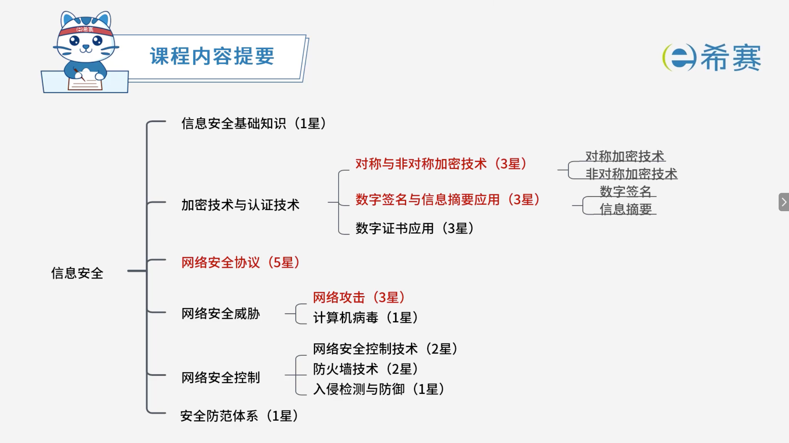
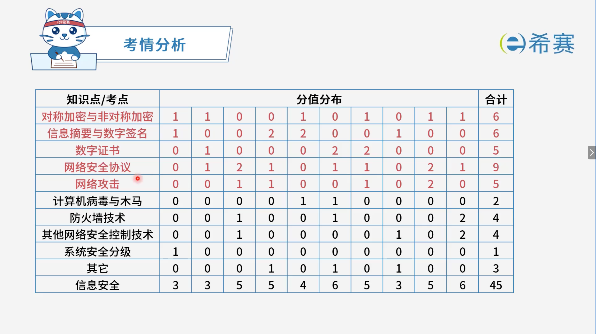

# 信息安全

## 1. 知识点分布

## 2. 历年考试分布

## 学习目录

- [信息安全的基本知识](./信息安全的基本知识.md)
- [计算机病毒](./计算机病毒.md)
- [加密技术与认证技术](./加密技术与认证技术.md)
- [数字签名](./数字签名.md)
- [数字证书](./数字证书.md)
- [网络安全协议](./网络安全协议.md)
- [网络攻击](./网络攻击.md)
- [网络安全控制技术](./网络安全控制技术.md)
- [安全防范体系](./安全防范体系.md)
