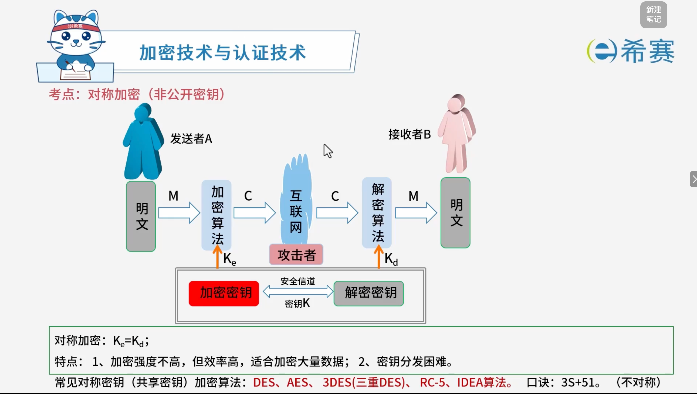
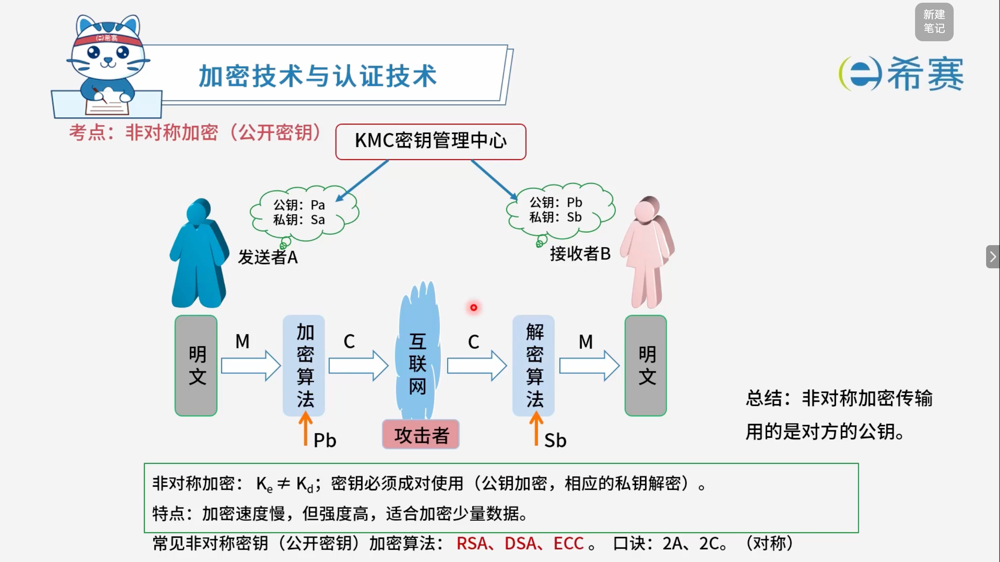

# 加密技术与认证技术

## 1. 考点：对称加密（非公开密钥）

### 1.1 对称加密核心原理与特点

- **基本原理**：

  - 发送者 A 使用加密密钥 $K_e$ 将明文 $M$ 加密为密文 $C$。
  - 接收者 B 通过解密密钥 $K_d$ 将密文 $C$ 解密还原为明文 $M$。
  - **核心等式**：$K_e = K_d$（即加密密钥与解密密钥相同，也称共享密钥）。
- **技术优缺点**：

  - **优点**：算法执行效率高、速度快，非常适合用于加密大量数据。
  - **缺点**：密钥分发困难（在不安全的信道中安全传输密钥较复杂）。

### 1.2 常见对称加密算法与记忆口诀

- **常见算法**：

  - **DES、AES、3DES（三重 DES）、RC-5、IDEA 算法**。
- **考试记忆口诀**：

  - **​`3S + 51`​**​ **（不对称）**  —— 帮助快速联想和区分对称加密算法家族。

## 2. 考点：非对称加密（公开密钥）

### 2.1 非对称加密核心原理与工作流程

- **基本密钥关系**：

  - 非对称加密中，$K_e \neq K_d$，即加密密钥与解密密钥不相同。
  - 密钥必须成对使用，遵循**公钥加密、相应的私钥解密**的原则。
- **加密与传输过程**：

  - 发送者 A 通过 KMC 密钥管理中心获取接收者 B 的公钥 ($P_b$)。
  - 发送者 A 使用接收者 B 的公钥将明文 ($M$) 通过加密算法加密成密文 ($C$)。
  - 密文通过不安全的互联网进行传输。
  - 接收者 B 收到密文后，使用自己专属的私钥 ($S_b$) 通过解密算法还原出明文 ($M$)。
- **核心结论**：

  - **非对称加密传输时，使用的是对方的公钥**。

### 2.2 技术特点与常见算法

- **技术优缺点**：

  - **优点**：安全性极高，密码强度大。
  - **缺点**：加解密计算复杂，加密速度慢。
  - **适用场景**​：由于其性能特点，它非常​**适合用于加密少量数据**（如数字签名、密钥交换等）。
- **常见非对称加密算法**：

  - **RSA、DSA、ECC** 等。

## 3. 考点：对称与非对称加密算法分类对照表

|**算法类型**|**子类别 / 特性**|**典型算法**|
| ------------------| ----| -------------------------|
|**对称加密算法**（共享密钥）|**分组加密** |DES、AES、3DES、IDEA 等|
||**流密码** |RC-5 等|
|**非对称加密算法**（公开密钥）|—|RSA、DSA、ECC 等|

### 3.1 考试重要标准与应用提示

- **国际标准证书**：

  - X.509 数字证书标准推荐使用 **RSA** 算法。
- **我国商用密码（国密）标准**：

  - 国密 **SM2** 数字证书采用的是 ​**ECC**（椭圆曲线密码学）算法。

## 4. 经典例题

### 4.1 题目一

> **题目：**  以下加密算法中适合对大量的明文消息进行加密传输的是（ ）。
>
> - A、RSA
> - B、SHA-1
> - C、MD5
> - D、RC5

 **【解析】**

- **正确答案：D**
- **解析说明：**

  - **关于选项 D（RC5）** ​：RC5 是一种​**对称加密算法**，加密速度快，适合对大量明文消息进行加密传输。
  - **其他选项说明**：

    - **A、RSA**​：是一种​**非对称加密算法**，加密速度较慢，通常用于加密少量数据或密钥。
    - **B、SHA-1**​：是一种​**哈希算法**，用于生成消息摘要，不可逆，不用于加密传输。
    - **C、MD5**​：是一种​**哈希算法**，用于生成消息摘要，不可逆，不用于加密传输。

**正确答案：D（RC5）。** 

---

### 4.2 题目二

> **题目：**  下列算法中，不属于公开密钥加密算法的是（ ）。
>
> - A、ECC
> - B、DSA
> - C、RSA
> - D、DES

 **【解析】**

- **正确答案：D**
- **解析说明：**

  - **关于选项 D（DES）** ​：DES 是一种​**对称加密算法**，加密和解密使用同一个密钥，不属于公开密钥（非对称）加密算法。
  - **其他选项说明**：

    - **A、ECC**：椭圆曲线密码学，属于公开密钥加密算法。
    - **B、DSA**：数字签名算法，属于公开密钥加密算法。
    - **C、RSA**：属于公开密钥加密算法。

**正确答案：D（DES）。** 

---

### 4.3 题目三

> **题目：**  AES 是一种（ ）算法。
>
> - A、公钥加密
> - B、流密码
> - C、分组加密
> - D、消息摘要

 **【解析】**

- **正确答案：C**
- **解析说明：**

  - **关于选项 C（分组加密）** ​：AES（高级加密标准）是一种​**对称分组加密算法**，它将明文分成固定长度的分组（128 位）进行加密。
  - **其他选项说明**：

    - **A、公钥加密**：AES 是对称加密算法，不是公钥加密算法。
    - **B、流密码**：AES 是分组加密算法，不是流密码。
    - **D、消息摘要**：AES 是加密算法，不是消息摘要算法。

**正确答案：C（分组加密）。**
