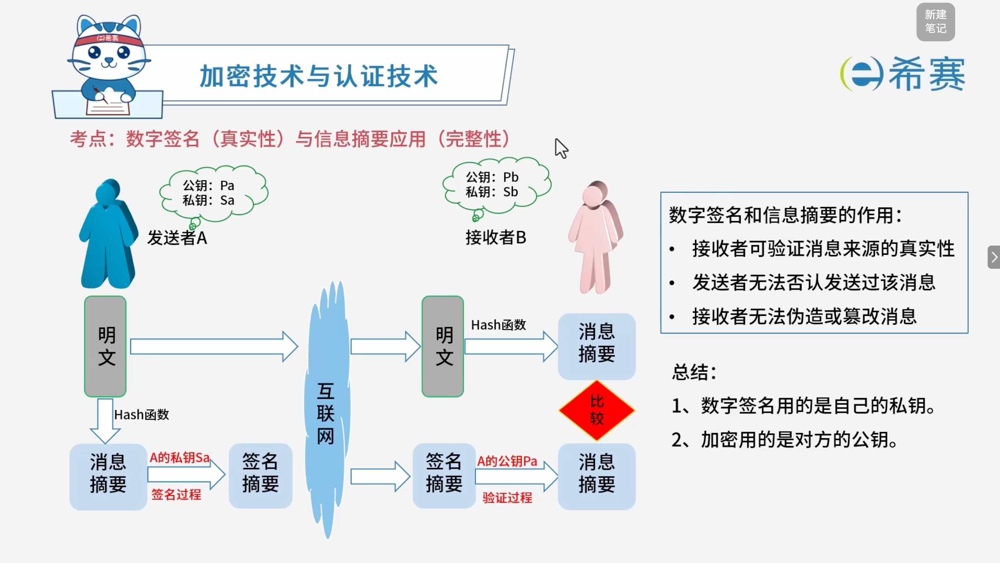

# 数字签名

## 1. 考点：加密技术与认证技术：数字签名与信息摘要详解

### 1.1 数字签名与信息摘要核心原理

- **信息摘要（保证完整性）** ：

  - 发送者 A 对明文通过 ​**Hash 函数**（散列函数）计算出一个固定长度的“消息摘要”。
  - 如果明文被篡改，计算出的摘要就会发生变化，从而能够检测出数据是否被篡改。
- **数字签名（保证真实性与不可否认性）** ：

  - 发送者 A 使用**自己的私钥 (**​**$S_a$**​ **)**  对消息摘要进行加密，形成数字签名。
  - 接收者 B 通过发送者 A 的公钥 ($P_a$) 对签名进行解密验证，并将收到的明文通过相同 Hash 函数计算摘要进行对比。

### 1.2 核心作用与考试总结口诀

- **数字签名和信息摘要的作用**：

  - 接收者可验证消息来源的**真实性**。
  - 发送者**无法否认**发送过该消息。
  - 接收者**无法伪造或篡改**消息。
- **核心规律总结**：

  1. **数字签名用的是自己的私钥**（用于身份认证与防抵赖）。
  2. **加解密用的是对方的公钥**（用于保证传输机密性）。

## 2. 考点：消息摘要与核心算法对照

- **数字摘要定义**：

  - 由单向散列函数将明文加密或转换成固定长度的散列值。
  - 例如：一段文本通过散列函数可以生成一串固定长度的乱码摘要（如 ​`%%&^#@(*&(@`）。
- **常用消息摘要算法及特性**：

  - 常用的消息摘要算法有 **MD5** 和 **SHA** 等。
  - **MD5 算法**​：生成的散列值长度为 ​**128位**。
  - **SHA 算法**​：生成的散列值长度为 ​**160位**。
  - **安全性对比**​：由于 SHA 通常采用的散列长度较长，因此其​**安全性高于 MD5**。

### 2.1 考试实用区分技巧

- **记忆口诀**：

  - **SHA “杀” 语气更重，长度更长**（SHA 对应的散列值长度为 160 位，大于 MD5 的 128 位）。

## 3. 经典例题

### 3.1 题目一

> **题目：**  可用于数字签名的算法是（ ）。
>
> - A、RSA
> - B、IDEA
> - C、RC-4
> - D、MD5

 **【解析】**

- **正确答案：A**
- **解析说明：**

  - **关于选项 A（RSA）** ​：RSA 是一种​**非对称加密算法**​，既可用于加密，也可用于​**数字签名**。使用私钥签名，公钥验证。
  - **其他选项说明**：

    - **B、IDEA**​：一种​**对称加密算法**，不能用于数字签名。
    - **C、RC-4**​：一种​**对称加密算法**，不能用于数字签名。
    - **D、MD5**​：一种​**消息摘要算法**，可以生成消息摘要，但本身不能用于数字签名，需要与非对称加密算法结合使用。

**正确答案：A（RSA）。** 

---

### 3.2 题目二

> **题目：**  MD5 是（ ）算法，对任意长度的输入计算得到的结果长度为（ ）位。
>
> **第一组选项：**
>
> - A、路由选择
> - B、摘要
> - C、共享密钥
> - D、公开密钥
>
> **第二组选项：**
>
> - A、56
> - B、128
> - C、140
> - D、160

 **【解析】**

- **正确答案：第一空选 B，第二空选 B。**
- **解析说明：**

  - **第一空：MD5 是（ B ）算法。**

    - MD5（Message Digest Algorithm 5）是一种​**消息摘要算法**，用于生成数据的摘要信息。
    - **A、路由选择**：属于网络层功能。
    - **C、共享密钥**：属于对称加密。
    - **D、公开密钥**：属于非对称加密。
  - **第二空：对任意长度的输入计算得到的结果长度为（ B ）位。**

    - MD5 对任意长度的输入计算得到的结果长度为 ​**128 位**（即 16 字节），通常表示为 32 位十六进制数。
    - **A、56**：DES 密钥长度。
    - **C、140**：不是标准摘要长度。
    - **D、160**：SHA-1 的结果长度。

**正确答案：第一空 B（摘要），第二空 B（128）。** 

---

### 3.3 题目三

> **题目：**  在安全通信中，S 将所发送的信息使用（ ）进行数字签名，T 收到该消息后可利用（ ）验证该消息的真实性。
>
> **第一组选项：**
>
> - A、S 的公钥
> - B、S 的私钥
> - C、T 的公钥
> - D、T 的私钥
>
> **第二组选项：**
>
> - A、S 的公钥
> - B、S 的私钥
> - C、T 的公钥
> - D、T 的私钥

 **【解析】**

- **正确答案：第一空选 B，第二空选 A。**
- **解析说明：**

  - **第一空：S 将所发送的信息使用（ B ）进行数字签名。**

    - 数字签名使用发送方（S）的**私钥**进行签名。
    - 只有 S 拥有自己的私钥，因此签名具有唯一性和不可抵赖性。
  - **第二空：T 收到该消息后可利用（ A ）验证该消息的真实性。**

    - T 收到消息后，使用发送方（S）的**公钥**来验证签名。
    - 如果验证成功，说明消息确实由 S 发送，且未被篡改。

**正确答案：第一空 B（S 的私钥），第二空 A（S 的公钥）。** 

---

### 3.4 题目四

> **题目：**  以下关于认证和加密的叙述中，错误的是（ ）。
>
> - A、加密用以确保数据的保密性
> - B、认证用以确保报文发送者和接收者的真实性
> - C、认证和加密都可以阻止对手进行被动攻击
> - D、身份认证的目的在于识别用户的合法性，阻止非法用户访问系统

 **【解析】**

- **正确答案：C**
- **解析说明：**

  - **关于选项 C**：说法错误。加密可以防止被动攻击（如窃听），但认证主要用于防止主动攻击（如伪造、篡改、重放），不能阻止被动攻击。被动攻击主要是窃听，认证无法阻止窃听行为。
  - **其他选项说明**：

    - **A、加密用以确保数据的保密性**：正确。
    - **B、认证用以确保报文发送者和接收者的真实性**：正确。
    - **D、身份认证的目的在于识别用户的合法性，阻止非法用户访问系统**：正确。

**正确答案：C（认证和加密都可以阻止对手进行被动攻击）。** 

‍
