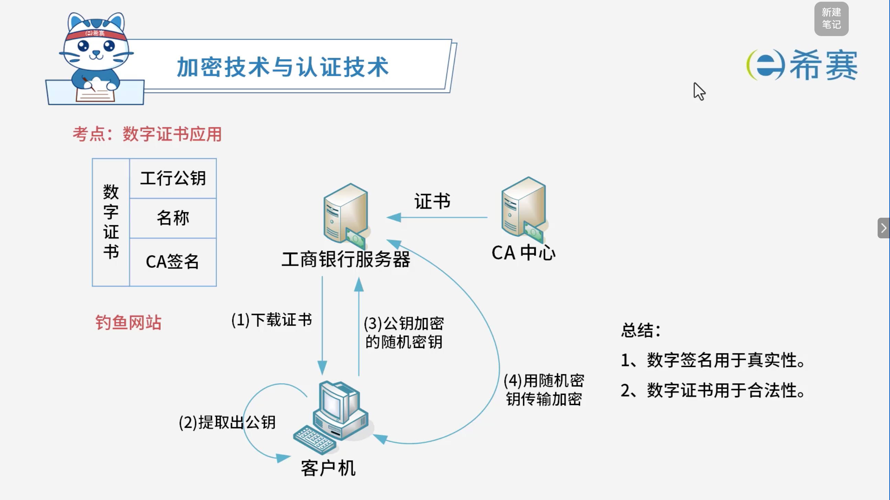

# 数字证书

## 1. 考点：数字证书应用

### 1.1 数字证书结构与应用流程

- **数字证书的组成**：

  - 主要包含：**服务器公钥**、**主体名称/持有者信息**以及 **CA 机构的数字签名**。
- **客户端与服务器交互过程**（以工商银行服务器为例）：

  1. **下载证书**：客户机向工商银行服务器请求并下载其数字证书。
  2. **提取公钥**：客户机通过 CA 的公钥验证证书合法性后，从中提取出服务器的公钥。
  3. **发送随机密钥**：客户机生成一个随机密钥，并使用提取到的服务器公钥进行加密后发送给服务器。
  4. **传输加密**：服务器用私钥解密获得随机密钥，之后双方利用该随机密钥进行对称加密传输通信。

### 1.2 核心考点总结

- **作用区分**：

  - **数字签名**：用于验证消息的**真实性**与防抵赖。
  - **数字证书**：用于验证身份和服务器的**合法性**（防止钓鱼网站）。

## 2. 经典例题

### 2.1 题目一

> **题目：**  假定用户 A、B 分别在 I1 和 I2 两个 CA 处取得了各自的证书，下面（ ）是 A、B 互信的必要条件。
>
> - A、A、B 互换私钥
> - B、A、B 互换公钥
> - C、I1、I2 互换私钥
> - D、I1、I2 互换公钥

 **【解析】**

- **正确答案：D**
- **解析说明：**

  - **关于选项 D（I1、I2 互换公钥）** ：A、B 分别在不同的 CA（I1 和 I2）处取得证书，要实现 A、B 之间的互信，两个 CA 需要互换公钥，以便验证对方签发的证书。
  - **其他选项说明**：

    - **A、A、B 互换私钥**：私钥不能交换，私钥必须保密。
    - **B、A、B 互换公钥**：公钥可以公开，但这不是 A、B 互信的必要条件，关键在 CA 之间互信。
    - **C、I1、I2 互换私钥**：私钥不能交换。

**正确答案：D（I1、I2 互换公钥）。** 

---

### 2.2 题目二

> **题目：**  用户 A 和 B 要进行安全通信，通信过程需确认双方身份和消息不可否认。A 和 B 通信时可使用（ ）来对用户的身份进行认证；使用（ ）确保消息不可否认。
>
> **第一组选项：**
>
> - A、数字证书
> - B、消息加密
> - C、用户私钥
> - D、数字签名
>
> **第二组选项：**
>
> - A、数字证书
> - B、消息加密
> - C、用户私钥
> - D、数字签名

 **【解析】**

- **正确答案：第一空选 A，第二空选 D。**
- **解析说明：**

  - **第一空：对用户的身份进行认证，使用（ A ）**

    - **数字证书**由权威的 CA 机构签发，用于证明用户的身份，是身份认证的常用手段。
    - **B、消息加密**：用于保证数据的保密性，不用于身份认证。
    - **C、用户私钥**：用于签名和解密，不能单独用于身份认证。
    - **D、数字签名**：用于验证消息的完整性和不可否认性，但身份认证通常依赖数字证书。
  - **第二空：确保消息不可否认，使用（ D ）**

    - **数字签名**使用发送方的私钥对消息进行签名，接收方用发送方的公钥验证，从而确保消息的不可否认性。
    - **A、数字证书**：用于身份认证。
    - **B、消息加密**：用于保密性。
    - **C、用户私钥**：是数字签名的一部分，但单独使用不能确保不可否认。

**正确答案：第一空 A（数字证书），第二空 D（数字签名）。**
