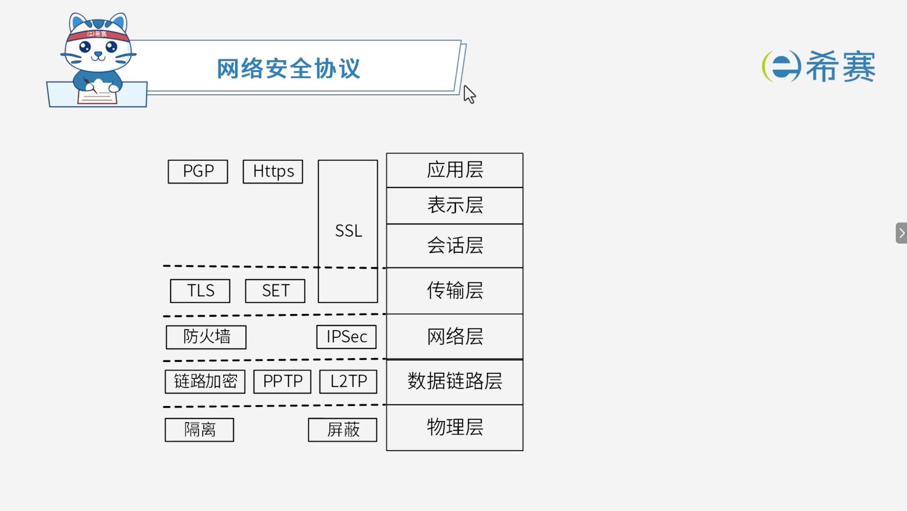

# 网络安全协议

## 1. 考点：网络安全协议分布图

### 1.1 常用网络安全协议及特点

- **PGP (Pretty Good Privacy)** ：

  - 优良保密协议。
  - 针对邮件和文件的混合加密系统。
- **SSL (Secure Sockets Layer)** ：

  - 安全套接字协议。
  - 工作在传输层至应用层。
- **TLS (Transport Layer Security)** ：

  - 传输层安全协议。
- **SET (Secure Electronic Transaction)** ：

  - 安全电子交易协议。
  - 用于电子商务和身份认证。
  - 普遍的说法是将其归为应用层。
- **IPSEC (Internet Protocol Security)** ：

  - 互联网安全协议。
  - 对 IP 包进行加密。

## 2. 经典例题

### 2.1 题目一

> **题目：**  与 HTTP 相比，HTTPS 协议对传输的内容进行加密，更加安全。HTTPS 基于（ ）安全协议，其默认端口是（ ）。
>
> **第一组选项：**
>
> - A、RSA
> - B、DES
> - C、SSL
> - D、SSH
>
> **第二组选项：**
>
> - A、1023
> - B、443
> - C、80
> - D、8080

 **【解析】**

- **正确答案：第一空选 C，第二空选 B。**
- **解析说明：**

  - **第一空：HTTPS 基于（ C ）安全协议。**

    - HTTPS（Hyper Text Transfer Protocol Secure）是基于 **SSL/TLS** 协议的安全 HTTP 协议，对传输内容进行加密。
    - **A、RSA**：非对称加密算法。
    - **B、DES**：对称加密算法。
    - **D、SSH**：安全外壳协议，用于远程登录。
  - **第二空：其默认端口是（ B ）。**

    - HTTPS 的默认端口是 ​**443**。
    - **A、1023**：不是标准端口。
    - **C、80**：HTTP 的默认端口。
    - **D、8080**：常用的代理端口。

**正确答案：第一空 C（SSL），第二空 B（443）。** 

---

### 2.2 题目二

> **题目：**  下述协议中与安全电子邮箱服务无关的是（ ）。
>
> - A、SSL
> - B、HTTPS
> - C、MIME
> - D、PGP

 **【解析】**

- **正确答案：C**
- **解析说明：**

  - **关于选项 C（MIME）** ​：MIME（多用途互联网邮件扩展）用于扩展电子邮件格式，使其能够支持非 ASCII 字符、二进制附件等，但它本身​**不提供安全功能**，与安全电子邮箱服务无关。
  - **其他选项说明**：

    - **A、SSL**：安全套接层协议，可用于加密邮件传输，与安全电子邮箱服务有关。
    - **B、HTTPS**：基于 SSL/TLS 的安全 HTTP 协议，可用于 Web 邮件服务的安全传输，与安全电子邮箱服务有关。
    - **D、PGP**：Pretty Good Privacy，是一种用于电子邮件加密和签名的安全协议，与安全电子邮箱服务有关。

**正确答案：C（MIME）。**
