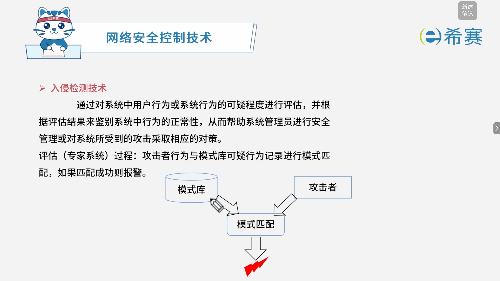
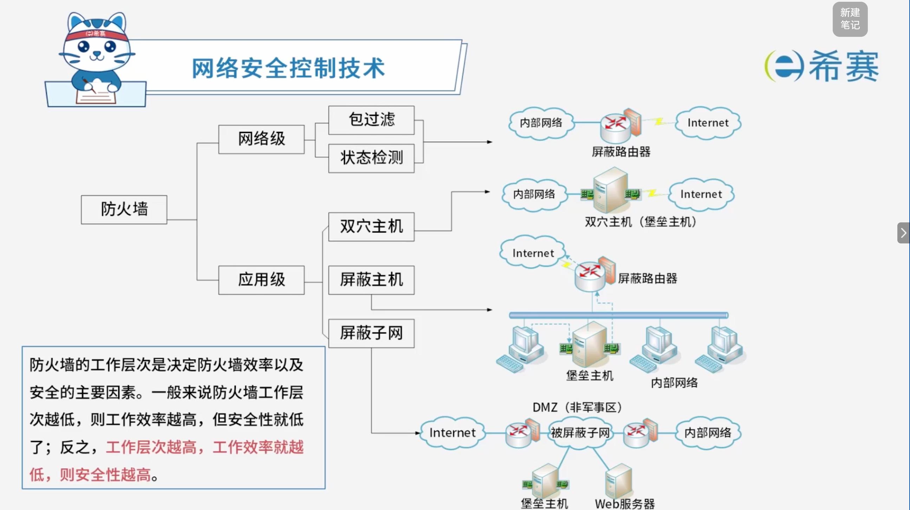

# 网络安全控制技术

## 1. 考点：信息的存储安全主要内容

- **信息使用的安全**：包括用户的标识与验证、用户存取权限控制、安全问题跟踪等。
- **系统安全监控**：对系统运行状态及访问行为进行实时监控。
- **计算机病毒防治**：对各类计算机病毒及恶意代码进行预防、检测与清除。
- **数据的加密**：通过加密技术确保存储数据的机密性。
- **防治非非法攻击**：防范各类针对存储系统的主动与被动攻击。

## 2. 考点：网络安全控制技术的分类

### 2.1 用户识别与验证核心要点

- **核心定义**：

  - 用户识别和验证的核心是识别访问者是否属于系统的合法用户，目的是防止非法用户进入系统。
- **常见认证方式**：

  - **口令认证**
  - **生物识别认证**
  - **U盾认证**
  - **多因子认证**

### 2.2 **访问控制技术**：

- 其核心是控制不同用户对信息资源的访问权限。

### 2.3 **访问控制列表 (ACL)**  ：

- **定义**：ACL 是一种基于包过滤的访问控制技术，它可以根据设定的条件对接口上的数据包进行过滤，允许其通过或丢弃。
- **应用场景**：被广泛地应用于路由器和三层交换机中。
- **核心作用**：借助访问控制列表，可以有效地控制用户对网络的访问，从而最大限度地保障网络安全；ACL 也可以结合防火墙使用。

### 2.4 漏洞扫描技术

- **核心定义**：

  - 漏洞监测和安全风险评估技术，可预知主体受攻击的可能性和具体地指将要发生的行为和产生的后果。
- **主要功能**：

  - 包括网络模拟攻击、漏洞监测、报告服务进程、提取对象信息以及测评风险、提供安全建议和改进等功能。
  - 帮助用户控制可能发生的安全事件，最大可能地消除安全隐患。
- **重要考点提示（避坑指南）** ：

  - 可以发现高风险和安全漏洞，**单纯的漏洞扫描技术是不包括修复功能的**。

### 2.5 入侵检测技术核心要点

- **核心定义**：

  - 通过对系统中用户行为或系统行为的可疑程度进行评估，并根据评估结果来鉴别系统中行为的正常性，从而帮助系统管理员进行安全管理或对系统所受到的攻击采取相应的对策。
- **评估（专家系统）过程**：

  - 攻击者行为与模式库可疑行为记录进行模式匹配，如果匹配成功则报警。

### 2.6 IDS 与 IPS 对比表

|**系统名称**|**网络中的部署位置**|**入侵响应能力**|
| ----------------------| ------------------------------| ----------------------------------------------------------------------------------------------------------------------------------------------------------------------------------------------|
|**IDS**（入侵检测系统）|IDS 一般是采用**旁路挂接**的方式。|IDS 设备对于网络中的入侵行为往往是采用将入侵行为计入日志，并向网络管理员发出报警的方式来处理的，对于入侵行为并未主动的采取对应措施，响应方式单一。|
|**IPS**（入侵防御系统）|IPS 一般是作为一种网络设备**串接在网络中**。|入侵防御系统检测到入侵行为后，能够对攻击行为进行主动的防御，例如丢弃攻击连接的数据包以阻断攻击会话，主动发送 ICMP 不可到达数据包、记录日志和动态的生成防御规则等多种方式对攻击行为进行防御。|

### 2.7 防火墙技术

- **核心作用**：

  - 防火墙的作用是防止不希望的、未经授权地进出被保护的内部网络，通过边界控制强化内部网络的安全策略。
- **工作机制与信任假设**：

  - 防火墙是建立在内外网络边界上的过滤封锁机制。
  - 它认为内部网络是安全和可信赖的，而外部网络是不安全和不可信赖的。

#### 2.7.1 防火墙的功能与特性要点

- **核心功能**：

  - **访问控制功能 (ACL)** ：对进出网络的数据包根据规则进行过滤。
  - **内容控制功能**：检查并过滤传输的具体内容。
  - **全面的日志功能**：记录网络访问与安全事件。
  - **集中管理功能**：便于统一配置和安全策略下发。
  - **自身的安全和可用性**：防火墙自身具备抗攻击与高可用设计。
- **附加功能**：

  - **流量控制**：对网络带宽和流量进行管理与限制。
  - **网络地址转换 (NAT)** ：实现内网私有 IP 与公网 IP 的转换。
  - **VPN**：提供安全的虚拟专用网络通道。

#### 2.7.2 防火墙分类与体系结构核心要点

- **防火墙分类**：

  - **网络级**：包含包过滤和状态检测。
  - **应用级**：工作在较高协议层，提供更深度的内容控制。
- **常见体系结构**：

  - **屏蔽路由器**：通过路由器结合访问控制列表（ACL）进行边界过滤。
  - **双穴主机（堡垒主机）** ：具有双重网络接口，作为内外网通信的唯一通道。
  - **屏蔽主机**：结合了屏蔽路由器与堡垒主机，将内部网络与 Internet 隔离开。
  - **屏蔽子网（DMZ 非军事区）** ：使用两个路由器构建一个隔离区（DMZ），放置对外提供服务的服务器（如 Web 服务器、堡垒主机），安全性最高。
- **工作层次与安全权衡（重要考点）** ：

  - 防火墙的工作层次是决定防火墙效率以及安全的主要因素。
  - **工作层次越低**：工作效率越高，但安全性就低了。
  - **工作层次越高**：工作效率越低，则安全性越高。

## 3. 经典例题

### 3.1 题目一

> **题目：**  （ ）不属于入侵检测技术。
>
> - A、专家系统
> - B、模型检测
> - C、简单匹配
> - D、漏洞扫描

 **【解析】**

- **正确答案：D**
- **解析说明：**

  - **关于选项 D（漏洞扫描）** ：漏洞扫描是一种**安全评估技术**，用于发现系统中存在的漏洞，不属于入侵检测技术。
  - **其他选项说明**：

    - **A、专家系统**：属于入侵检测技术，利用专家知识库进行检测。
    - **B、模型检测**：属于入侵检测技术，基于模型进行异常检测。
    - **C、简单匹配**：属于入侵检测技术，通过模式匹配检测入侵行为。

**正确答案：D（漏洞扫描）。** 

---

### 3.2 题目二

> **题目：**  访问控制是对信息系统资源进行保护的重要措施，适当的访问控制能够阻止未经授权的用户有意或者无意地获取资源。计算机系统中，访问控制的任务不包括（ ）。
>
> - A、审计
> - B、授权
> - C、确定存取权限
> - D、实施存取权限

 **【解析】**

- **正确答案：A**
- **解析说明：**

  - **关于选项 A（审计）** ：审计是对系统操作进行记录和分析，属于**安全审计**的范畴，不属于访问控制的任务。
  - **其他选项说明**：

    - **B、授权**：访问控制的任务包括授权，即确定用户对资源的访问权限。
    - **C、确定存取权限**：访问控制的任务包括确定存取权限。
    - **D、实施存取权限**：访问控制的任务包括实施存取权限。

**正确答案：A（审计）。** 

---

### 3.3 题目三

> **题目：**  以下关于防火墙功能特性的叙述中，不正确的是（ ）。
>
> - A、控制进出网络的数据包和数据流向
> - B、提供流量信息的日志和审计
> - C、隐藏内部 IP 以及网络结构细节
> - D、提供漏洞扫描功能

 **【解析】**

- **正确答案：D**
- **解析说明：**

  - **关于选项 D（提供漏洞扫描功能）** ：防火墙的主要功能是控制网络访问、过滤数据包、提供日志和审计、隐藏内部网络结构等，但**不提供漏洞扫描功能**。漏洞扫描是单独的安全评估工具的功能。
  - **其他选项说明**：

    - **A、控制进出网络的数据包和数据流向**：防火墙的核心功能。
    - **B、提供流量信息的日志和审计**：防火墙的常见功能。
    - **C、隐藏内部 IP 以及网络结构细节**：防火墙可以通过 NAT 等技术实现。

**正确答案：D（提供漏洞扫描功能）。** 

---

### 3.4 题目四

> **题目：**  （ ）防火墙是内部网和外部网的隔离点，它可对应用层的通信数据流进行监控和过滤。
>
> - A、包过滤
> - B、应用级网关
> - C、数据库
> - D、Web

 **【解析】**

- **正确答案：B**
- **解析说明：**

  - **关于选项 B（应用级网关）** ：应用级网关（代理服务器）工作在**应用层**，能够对应用层的通信数据流进行监控和过滤，是内部网和外部网的隔离点。
  - **其他选项说明**：

    - **A、包过滤**：工作在**网络层**，根据数据包的源地址、目的地址、端口号等进行过滤，不能对应用层数据流进行监控和过滤。
    - **C、数据库**：不是防火墙类型。
    - **D、Web**：不是防火墙类型。

**正确答案：B（应用级网关）。** 

