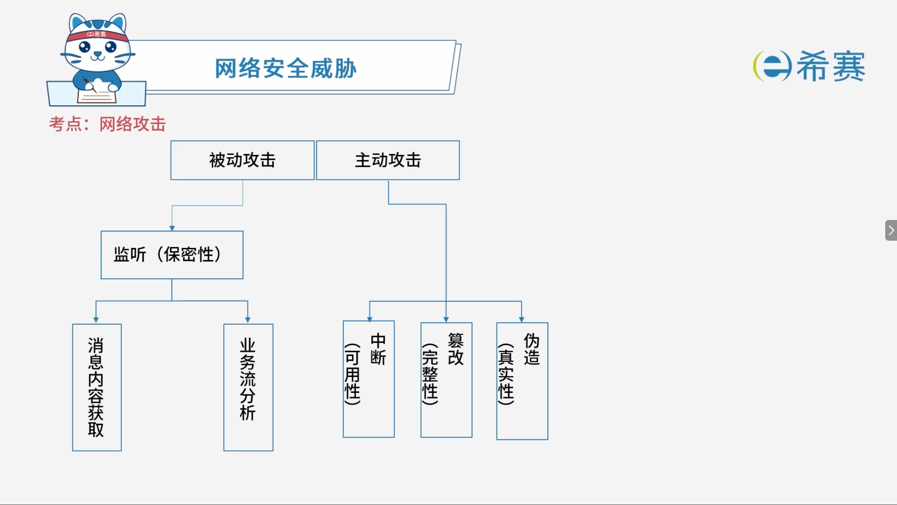

# 网络攻击

## 1. 考点：网络攻击的分类

### 1.1 网络攻击分类对照表

|**攻击大类**|**子类型与具体手段**|**破坏的安全要素**|
| --| ----------------------------------------------------------| --------|
|**被动攻击**|监听（主要针对系统流量或数据进行窃听、观察，不改动内容）|破坏**保密性** |
||\* 消息内容获取||
||\* 业务流分析||
|**主动攻击**|**中断**（主动对系统资源进行干扰或阻断）|破坏**可用性** |
||**篡改**（主动对传输的数据流进行修改、删除、插入）|破坏**完整性** |
||**伪造**（冒充合法实体发送虚假信息或进行身份欺骗）|破坏**真实性**|

### 1.2 被动攻击形式与描述对照表

|**攻击类型**|**攻击名称**|**描述**|
| --| --| ------------------------------------------------------------------------------------------------------------------------------------|
|**被动攻击**|**窃听（网络监听）**|用各种可能的合法或非法的手段窃取系统中的信息资源和敏感信息。|
||**业务流分析**|通过对系统进行长期监听，利用统计分析方法对诸如通信频度、通信的信息流向、通信总量的变化等参数进行研究，从而发现有价值的信息和规律。|
||**非法登录**|有些资料将这种方式归为被动攻击方式。|

### 1.3 主动攻击形式与描述对照表

|**攻击类型**|**攻击名称**|**描述**|
| --| --| ----------------------------------------------------------------------------------------------------------------------------------|
|**主动攻击**|**假冒身份**|通过欺骗通信系统（或用户）达到非法用户冒充成为合法用户，或者特权小用户冒充成为特权大用户的目的，黑客大多是采用假冒身份进行攻击。|
||**抵赖**|这是一种来自用户的攻击，比如：否认自己曾经发布过的某条消息、伪造一份对方来信等。|
||**旁路控制**|攻击者利用系统的安全缺陷或安全性上的脆弱之处获得非授权的权利或特权。|
||**重放攻击**|所截获的某次合法的通信数据拷贝，出于非法的目的而被重新发送（**时间戳可防御**）。|

### 1.4 Web 服务器常见威胁与防御对照表

|**攻击类型**|**攻击名称**|**描述与防御手段**|
| ----| ----| --------------------------------------------------------------------------------------------------------------------------------------------------------------------------------------------------------------------------------------------|
|**主动攻击：Web 服务器常见威胁** |**拒绝服务 (DoS)**  |对信息或其它资源的合法访问被无条件地阻止。|
||**SQL 注入** |通过把 SQL 命令插入到 Web 表单提交或输入域名或页面请求的查询字符串，最终达到欺骗服务器执行恶意的 SQL 命令，其首要目的是获取数据库访问权限。对用户输入做关键字过滤、Web 应用防火墙、定期扫描系统漏洞并及时修复都可以有效防御 SQL 注入攻击。|

- **Web 应用防火墙**：具有 Web 应用相关的防护能力，比如防 SQL 注入、网页防篡改等功能。

## 2. 经典例题

### 2.1 题目一

> **题目：**  下列攻击行为中，属于典型被动攻击的是（ ）。
>
> - A、拒绝服务攻击
> - B、会话拦截
> - C、系统干涉
> - D、修改数据命令

 **【解析】**

- **正确答案：B**
- **解析说明：**

  - **关于选项 B（会话拦截）** ：会话拦截属于典型的**被动攻击**。被动攻击是指在不影响网络正常通信的情况下，对传输的数据进行窃听、拦截、截获等操作，会话拦截正是拦截通信双方的会话内容。
  - **其他选项说明**：

    - **A、拒绝服务攻击**：属于**主动攻击**，通过耗尽系统资源使服务不可用。
    - **C、系统干涉**：属于**主动攻击**，对系统进行干扰和破坏。
    - **D、修改数据命令**：属于**主动攻击**，篡改传输中的数据。

**正确答案：B（会话拦截）。** 

---

### 2.2 题目二

> **题目：**  攻击者通过发送一个目的主机已经接收过的报文来达到攻击目的，这种攻击方式属于（ ）攻击。
>
> - A、重放
> - B、拒绝服务
> - C、数据截获
> - D、数据流分析

 **【解析】**

- **正确答案：A**
- **解析说明：**

  - **关于选项 A（重放）** ：重放攻击是指攻击者发送一个目的主机已经接收过的报文，来达到欺骗系统的目的。这种攻击方式属于**重放攻击**。
  - **其他选项说明**：

    - **B、拒绝服务**：通过耗尽系统资源使服务不可用。
    - **C、数据截获**：属于被动攻击，窃听数据。
    - **D、数据流分析**：属于被动攻击，分析通信流量特征。

**正确答案：A（重放）。** 

