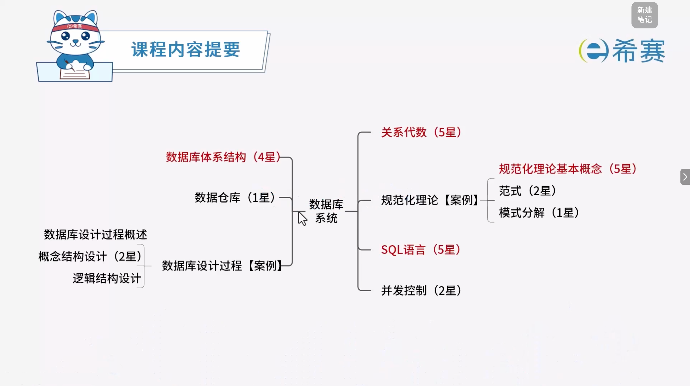
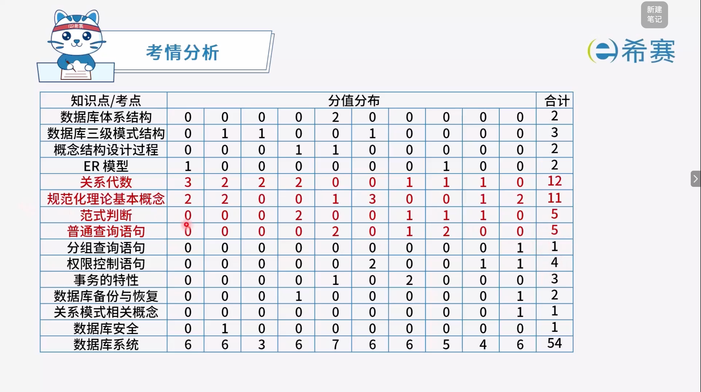

# 数据库系统

## 1. 知识点分布

## 2. 历年考试分布

## 学习目录

- [数据库体系结构](./数据库体系结构.md)
- [关系代数](./关系代数.md)
- [SQL语言](./SQL语言.md)
- [数据库设计过程概述](./数据库设计过程概述.md)
- [数据库概念结构设计](./数据库概念结构设计.md)
- [数据库逻辑结构设计](./数据库逻辑结构设计.md)
- [规范化](./规范化.md)
- [模式分解](./模式分解.md)
- [并发控制](./并发控制.md)
- [分布式数据库的特点](./分布式数据库的特点.md)
- [数据仓库](./数据仓库.md)
