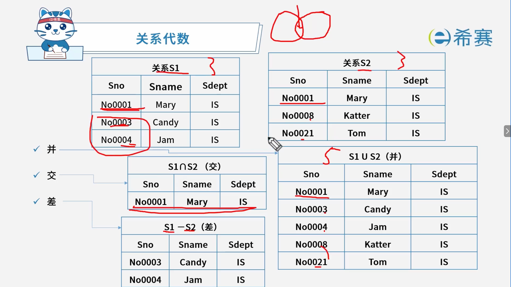
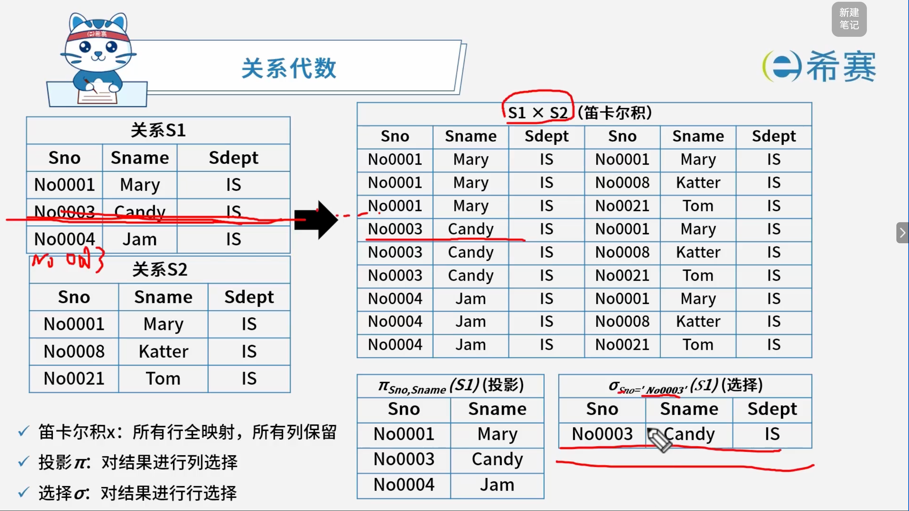
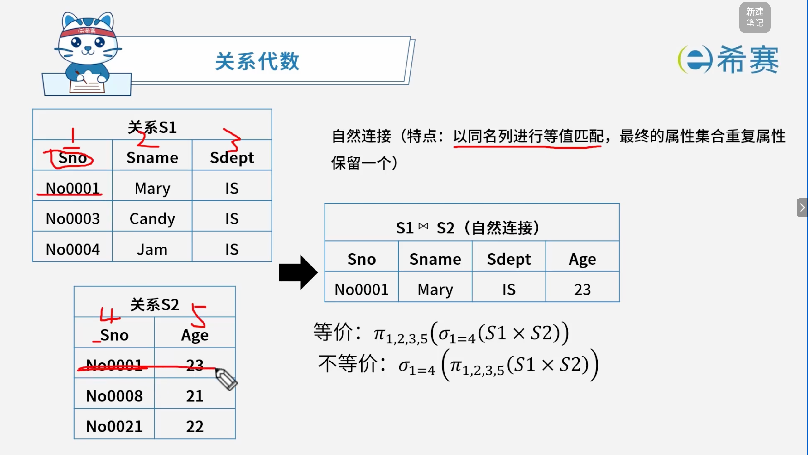

# 关系代数

## 1. 考点：并、交、差

## 2. 考点：笛卡尔积、选择、投影

## 3. 考点：自然链接

## 4. 经典例题

### 4.1 题目一

> **题目：**  给定关系 $R(A, B, C, D)$ 和 $S(C, D, E)$，若关系 $R$ 与 $S$ 进行自然连接运算，则运算后的元组属性列数为（ ）；关系代数表达式 $\pi_{1,4}(\sigma_{2=5}(R \bowtie S))$ 与（ ）等价。
>
> **第一组选项：**
>
> - A、4
> - B、5
> - C、6
> - D、7
>
> **第二组选项：**
>
> - A、$\pi_{A,D}(\sigma_{C=D}(R \bowtie S))$
> - B、$\pi_{R.A,R.D}(\sigma_{R.B=S.C}(R \bowtie S))$
> - C、$\pi_{A,R.D}(\sigma_{R.C=S.D}(R \bowtie S))$
> - D、$\pi_{R.A,R.D}(\sigma_{R.B=S.E}(R \bowtie S))$

 **【解析】**

- **正确答案：第一空选 B，第二空选 D。**
- **解析说明：**

  - **第一空：运算后的元组属性列数为（ B ）**

    - 关系 $R(A, B, C, D)$ 有 4 个属性。
    - 关系 $S(C, D, E)$ 有 3 个属性。
    - 自然连接 $R \bowtie S$ 会去掉重复的公共属性 $C$ 和 $D$，合并为一个。
    - 因此，自然连接后的属性为：$A$、$B$、$C$、$D$、$E$，共 **5 个**属性。
  - **第二空：关系代数表达式** **$\pi_{1,4}(\sigma_{2=5}(R \bowtie S))$** **与（ D ）等价。**

    - 自然连接后属性顺序为：$A$、$B$、$C$、$D$、$E$。
    - $\pi_{1,4}$ 表示取第 1 列和第 4 列，即 $A$ 和 $D$。
    - $\sigma_{2=5}$ 表示第 2 列等于第 5 列，即 $B = E$。
    - 因此，$\pi_{1,4}(\sigma_{2=5}(R \bowtie S))$ 等价于 $\pi_{R.A,R.D}(\sigma_{R.B=S.E}(R \bowtie S))$。
    - 选项 D 为 $\pi_{R.A,R.D}(\sigma_{R.B=S.E}(R \bowtie S))$，正确。

**正确答案：第一空 B（5），第二空 D（** **$\pi_{R.A,R.D}(\sigma_{R.B=S.E}(R \bowtie S))$** **）。** 

---

这道题的核心辨析点：

> **自然连接**：
>
> - 去掉重复的公共属性，合并为一个。
> - 属性列数 = $R$ 的属性数 + $S$ 的属性数 - 公共属性数。
>
> **关系代数表达式**：
>
> - $\pi_{1,4}$ 表示取第 1、4 列。
> - $\sigma_{2=5}$ 表示第 2 列等于第 5 列。
> - 自然连接后属性顺序：$A$、$B$、$C$、$D$、$E$。
> - 第 2 列是 $B$，第 5 列是 $E$，所以是 $B = E$。
