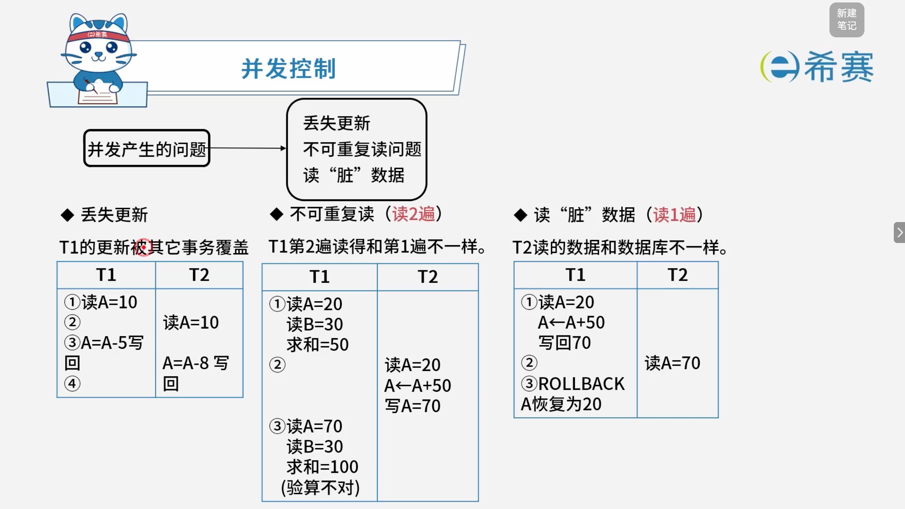
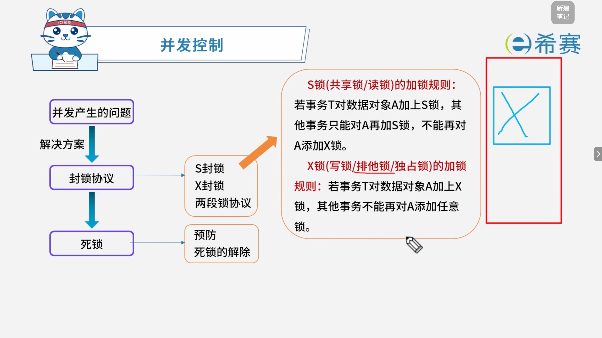
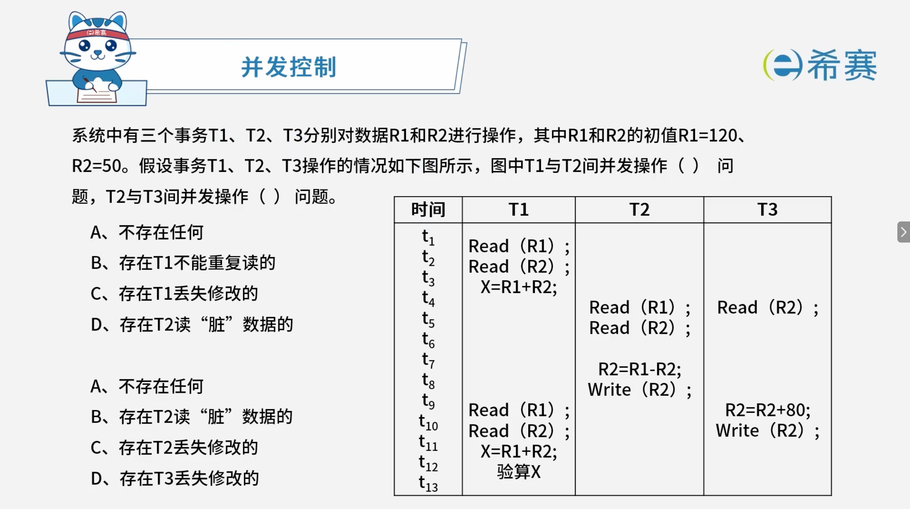

# 并发控制

## 1. 考点：并发控制：事务的 ACID 特性

### 1.1 事务的基本概念

事务（Transaction）是并发控制的基本单位，必须具备著名的 **ACID** 四大特性以确保数据的正确与安全：

### 1.2 ACID 特性详解

- **原子性（Atomicity）** ：

  - 事务是原子的，是一个不可分割的工作单位。
  - 操作“要么都做，要么都不做”。
- **一致性（Consistency）** ：

  - 事务执行的结果必须保证数据库从一个一致性状态变到另一个一致性状态。
- **隔离性（Isolation）** ：

  - 事务相互隔离。
  - 当多个事务并发执行时，任一事务的更新操作直到其成功提交的整个过程，对其他事务都是不可见的。
- **持久性（Durability）** ：

  - 一旦事务成功提交，即使数据库崩溃，其对数据库的更新操作也永久有效。

## 2. 考点：并发产生的三大问题

在多事务并发执行时，如果不加控制，可能会破坏事务的隔离性与一致性，主要会产生以下三种问题：

### 2.1 丢失更新 (Lost Update)

- **概念**：当两个或多个事务读取同一数据并修改，后提交的事务会覆盖先提交事务的更新结果，导致先发事务的修改“丢失”。
- **实例分析**：

  - $T_1$ 读取 $A = 10$。
  - $T_2$ 也读取 $A = 10$。
  - $T_1$ 修改 $A = A - 5$ 并写回（此时 $A = 5$）。
  - $T_2$ 修改 $A = A - 8$ 并写回（此时 $A = 2$，覆盖了 $T_1$ 的修改，导致 $T_1$ 的更新丢失）。

### 2.2 不可重复读 (Non-Repeatable Read，读 2 遍)

- **概念**：指事务 $T_1$ 读取数据后，另一事务 $T_2$ 执行了更新操作，导致 $T_1$ 再次读取该数据时，发现前后内容或结果不一致。
- **实例分析**：

  - $T_1$ 读取 $A = 20$、$B = 30$，求和得 $50$。
  - $T_2$ 修改 $A = A + 50$ 并写回（$A = 70$）。
  - $T_1$ 再次读取 $A = 70$、$B = 30$，求和得 $100$。
  - **结果**：两次读取结果不一致（验算不对）。

### 2.3 读“脏”数据 (Dirty Read，读 1 遍)

- **概念**：指事务 $T_1$ 修改了某个数据并写入数据库，但尚未提交；随后 $T_2$ 读取了该数据。接着 $T_1$ 由于某种原因进行了 `ROLLBACK` 撤销操作，导致 $T_2$ 读到的数据与数据库中的真实数据不一致。
- **实例分析**：

  - $T_1$ 读取 $A = 20$，修改 $A = A + 50$ 并写回（临时变为 $70$）。
  - $T_2$ 读取了此时的 $A = 70$。
  - $T_1$ 执行 `ROLLBACK` 撤销， $A$ 恢复为 $20$。
  - **结果**：$T_2$ 刚才读到的 $70$ 成为无效的“脏数据”。

## 3. 考点：封锁协议与锁机制

### 3.1 封锁协议与基本锁类型

为了解决并发产生的问题（如丢失更新、不可重复读、读脏数据），数据库系统通常采用**封锁协议**。常用的基本锁有两种：

- **S 锁（共享锁 / 读锁）** ：

  - **加锁规则**：若事务 $T$ 对数据对象 $A$ 加上 $S$ 锁，其他事务只能对 $A$ 再加 $S$ 锁，**不能**对 $A$ 添加 $X$ 锁。
  - **含义**：多个事务可以同时读同一对象，但不能修改。
- **X 锁（写锁 / 排他锁 / 独占锁）** ：

  - **加锁规则**：若事务 $T$ 对数据对象 $A$ 加上 $X$ 锁，其他事务**不能**再对 $A$ 添加任意锁（包括 $S$ 锁和 $X$ 锁）。
  - **含义**：仅允许加锁的事务对对象进行读写，其他事务无法访问。

### 3.2 死锁问题与处理

- **死锁的产生**：在运用封锁协议进行并发控制时，若多个事务各自占有部分资源并请求对方占有的资源，可能导致无限期等待，从而产生**死锁**。
- **死锁的处理策略**：

  - **预防死锁**：在事务执行前采取措施破坏死锁发生的条件（如一次封锁法、顺序封锁法）。
  - **死锁的解除**：允许死锁发生，系统定时运行死锁检测机制，一旦发现死锁，选择一个代价较小的事务进行撤销（`ROLLBACK`），释放其锁资源，解除死锁状态。

## 4. 经典例题

### 4.1 题目一

> **题目：**  事务的（ ）是指，当某个事务提交（COMMIT）后，对数据库的更新操作可能还停留在服务器磁盘缓冲区而未写入到磁盘时，即使系统发生故障，事务的执行结果仍不会丢失。
>
> - A、原子性
> - B、一致性
> - C、隔离性
> - D、持久性

 **【解析】**

- **正确答案：D**
- **解析说明：**

  - **关于选项 D（持久性）** ：持久性是指事务一旦提交，其对数据库的更新操作就是永久性的，即使系统发生故障，事务的执行结果也不会丢失。
  - **其他选项说明**：

    - **A、原子性**：事务的所有操作要么全部执行，要么全部不执行。
    - **B、一致性**：事务执行前后，数据库都必须处于一致状态。
    - **C、隔离性**：多个事务并发执行时，一个事务的执行不应影响其他事务。

**正确答案：D（持久性）。** 

### 4.2 题目二

> 

 **【解析】**

- **正确答案：第一空选 B，第二空选 C。**
- **解析说明：**

  - **第一空：T1 与 T2 间并发操作存在（ B ）问题。**

    - T1 在 t₁ 读取 R1\=120，t₂ 读取 R2\=50，t₃ 计算 X\=R1+R2\=170。
    - T2 在 t₄ 读取 R1\=120，t₅ 读取 R2\=50，t₇ 计算 R2\=R1-R2\=70，t₈ 写回 R2\=70。
    - T1 在 t₉ 再次读取 R1，t₁₀ 再次读取 R2，此时 R2 已被 T2 修改为 70，T1 两次读取的 R2 不一致（50 和 70）。
    - 因此，T1 与 T2 间存在**不可重复读**问题，选项 B 正确。
  - **第二空：T2 与 T3 间并发操作存在（ C ）问题。**

    - T2 在 t₇ 计算 R2\=R1-R2\=70，并在 t₈ 写回 R2\=70。
    - T3 在 t₄ 读取 R2\=50，在 t₁₀ 计算 R2\=R2+80\=130，并在 t₁₁ 写回 R2\=130。
    - T3 的修改覆盖了 T2 的修改，导致 T2 的修改被丢失。
    - 因此，T2 与 T3 间存在**丢失修改**问题，选项 C 正确。

**正确答案：第一空 B（存在T1不能重复读的），第二空 C（存在T2丢失修改的）。** 

### 4.3 题目三

> **题目：**  若事务 T1 对数据 D1 加了共享锁，事务 T2、T3 分别对数据 D2 和数据 D3 加了排它锁，则事务（ ）。
>
> - A、T1 对数据 D2、D3 加排它锁都成功，T2、T3 对数据 D1 加共享锁成功
> - B、T1 对数据 D2、D3 加排它锁都失败，T2、T3 对数据 D1 加排它锁成功
> - C、T1 对数据 D2、D3 加共享锁都成功，T2、T3 对数据 D1 加共享锁成功
> - D、T1 对数据 D2、D3 加共享锁都失败，T2、T3 对数据 D1 加共享锁成功

 **【解析】**

- **正确答案：D**
- **解析说明：**

  - **锁的兼容性规则**：

    |当前锁 \\ 请求锁|共享锁（S）|排它锁（X）|
    | :-------------------------------------------------| :-----------------------------------------| :-----------------------------------------|
    |共享锁（S）|兼容|不兼容|
    |排它锁（X）|不兼容|不兼容|
  - **分析各个事务的操作**：

    - T1 对 D1 加了**共享锁**。
    - T2 对 D2 加了**排它锁**。
    - T3 对 D3 加了**排它锁**。
  - **T1 对 D2、D3 加共享锁**：

    - D2 上已有 T2 的排它锁，T1 请求共享锁与排它锁**不兼容**，因此失败。
    - D3 上已有 T3 的排它锁，T1 请求共享锁与排它锁**不兼容**，因此失败。
    - 所以 T1 对 D2、D3 加共享锁**都失败**。
  - **T2、T3 对 D1 加共享锁**：

    - D1 上已有 T1 的共享锁，T2 请求共享锁与共享锁**兼容**，因此成功。
    - D1 上已有 T1 的共享锁，T3 请求共享锁与共享锁**兼容**，因此成功。
    - 所以 T2、T3 对 D1 加共享锁**都成功**。

**正确答案：D（T1 对数据 D2、D3 加共享锁都失败，T2、T3 对数据 D1 加共享锁成功）。**
