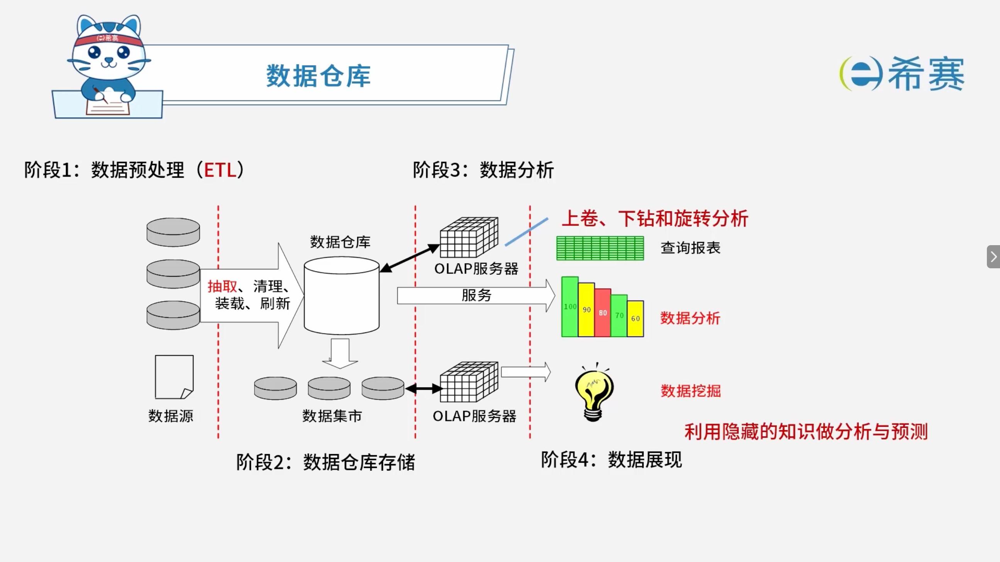

# 数据仓库

## 1. 考点：数据仓库的特点

- **面向主题**：数据按主题组织。
- **集成的**：消除了源数据中的不一致性，提供整个企业的一致性全局信息。
- **相对稳定的（非易失的）** ：主要进行查询操作，只有少量的修改和删除操作（或是不删除）。
- **反映历史变化（随着时间变化）** ：记录了企业从过去某一时刻到当前各个阶段的信息，可对发展历程和未来趋势做定量分析和预测。

## 2. 考点：数据仓库的处理阶段

## 3. 经典例题

### 3.1 题目一

> **题目：**  某集团公司下属有多个超市，每个超市的所有销售数据最终要存入公司的数据仓库中。假设该公司高管需要从时间、地区和商品种类三个维度来分析某家电商品的销售数据，那么最适合采用（ ）来完成。
>
> - A、Data Extraction
> - B、OLAP
> - C、OLTP
> - D、ETL

 **【解析】**

- **正确答案：B**
- **解析说明：**

  - **关于选项 B（OLAP）** ：OLAP（联机分析处理）主要用于**多维数据分析**，支持从不同维度（如时间、地区、商品种类）对数据进行切片、切块、钻取等操作，非常适合题干中“从时间、地区和商品种类三个维度来分析销售数据”的需求。
  - **其他选项说明**：

    - **A、Data Extraction**：数据抽取，是 ETL 过程中的一个环节，不是用于多维分析的工具。
    - **C、OLTP**：联机事务处理，主要用于日常事务处理（如增删改查），不适合复杂多维分析。
    - **D、ETL**：数据抽取、转换、加载，用于将数据从源系统导入数据仓库，不是用于多维分析。

**正确答案：B（OLAP）。**
