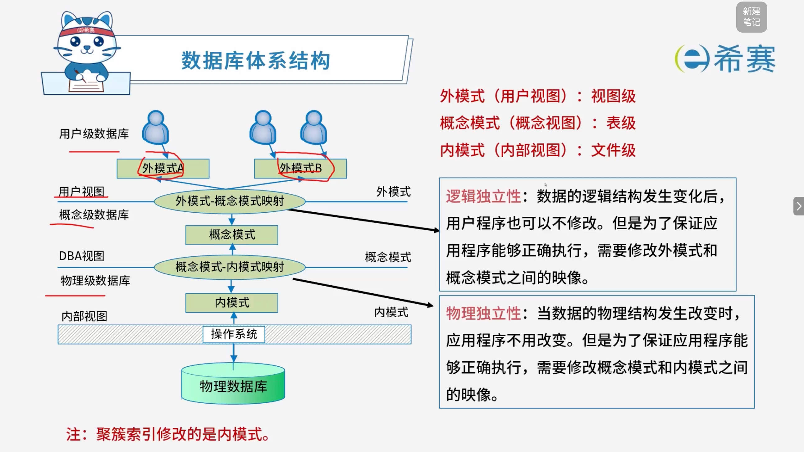

# 数据库体系结构

## 1. 考点：数据库的分类

|**体系结构类型**|**核心特点与说明**|
| --| ---------------------------------------------------------------------------------------------------------------------------|
|**集中式数据库系统**|• 数据是集中的  • 数据管理是集中的  • 数据库系统的所有功能（从形式的用户接口到DBMS核心）都集中在DBMS所在的计算机。|
|**C/S 结构**|• 客户端负责数据表示服务  • 服务器主要负责数据库服务  • 数据库系统分为前端和后端  • 涉及 ODBC、JDBC 等技术|
|**分布式数据库**|• 物理上分布、逻辑上集中  • 物理上分布、逻辑上分布  • 具备特定的系统特点  • 具备透明性|
|**并行数据库**|• 共享内存式  • 无共享式|

## 2. 考点：数据库的三层结构

