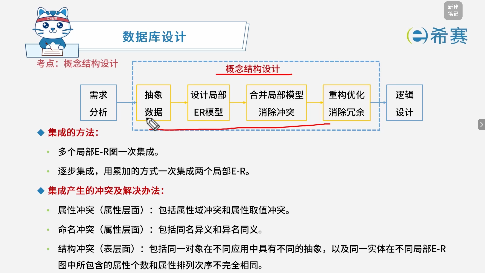
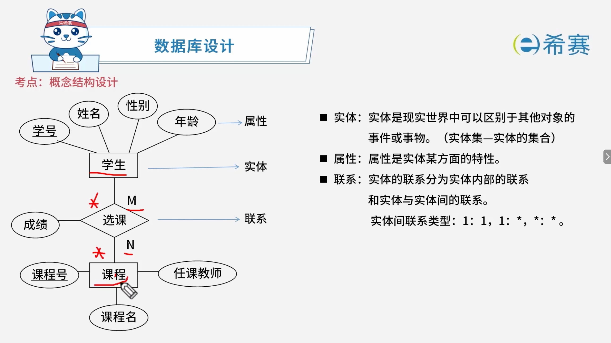
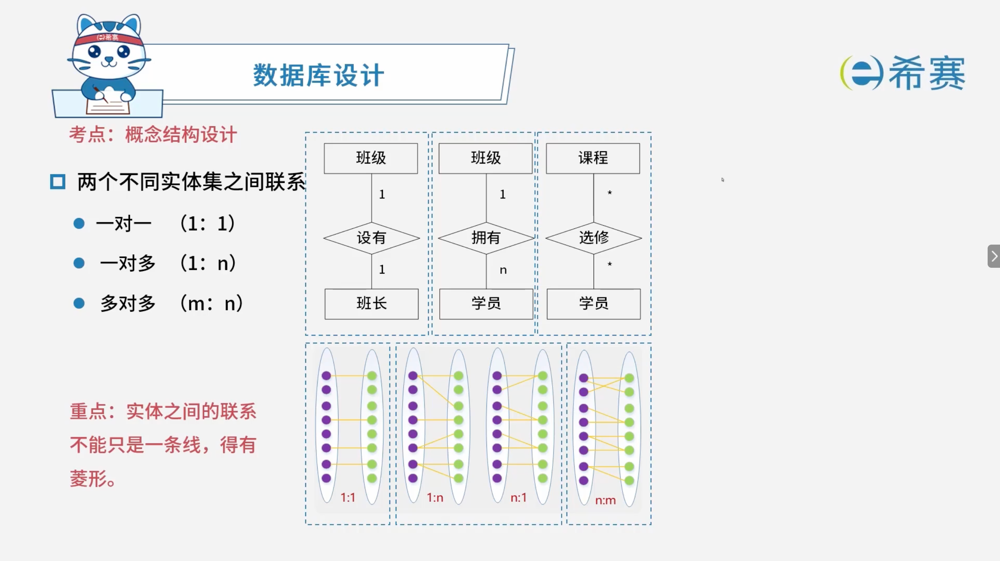
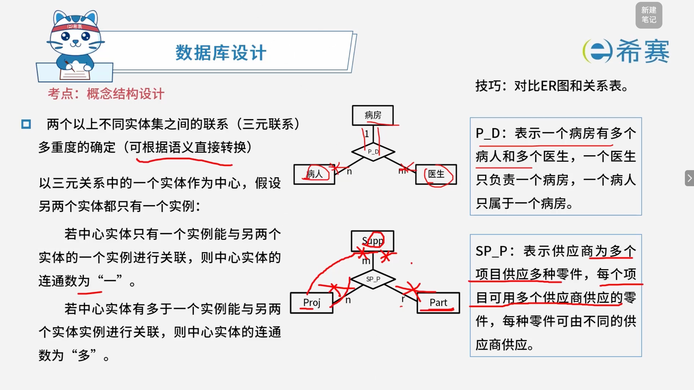
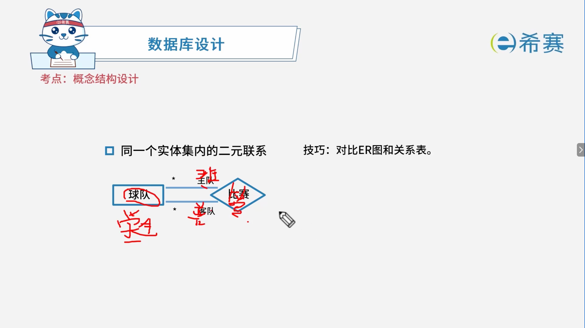
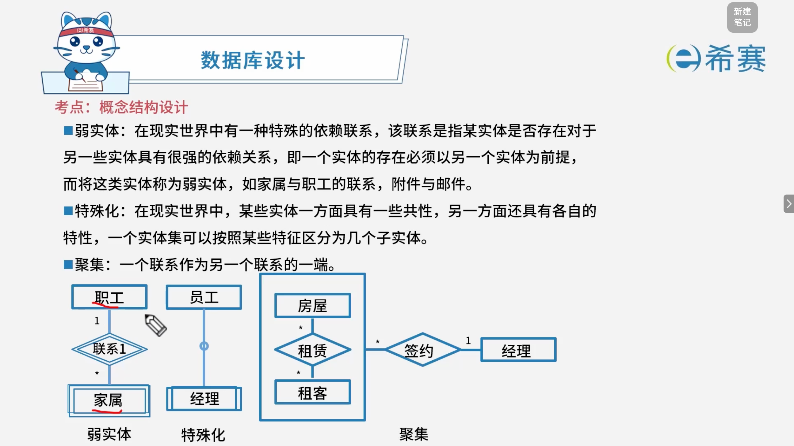

# 数据库概念结构设计

## 1. 考点：概念设计过程

### 1.1 概念结构设计流程

- **设计步骤**：从需求分析出发，经过抽象数据、设计局部 E-R 模型、合并局部模型并消除冲突、重构优化并消除冗余，最终进入逻辑设计阶段。
- 

### 1.2 局部 E-R 图的集成方法

- **一次集成**：多个局部 E-R 图一次性进行集成。
- **逐步集成**：用累加的方式，每次集成两个局部 E-R 图。

### 1.3 集成产生的冲突及分类

- **属性冲突（属性层面）** ：包括属性域冲突和属性取值冲突。
- **命名冲突（属性层面）** ：包括同名异义和异名同义。
- **结构冲突（表层面）** ：包括同一对象在不同应用中具有不同的抽象，以及同一实体在不同局部 E-R 图中所包含的属性个数和属性排列次序不完全相同。

## 2. 考点：E-R图中实体之间的关系

### 2.1 实体属性

- **简单属性和复合属性**

  - **简单属性**是原子的，不可再分的。
  - **复合属性**可以细分为更小的部分（即划分为别的属性）。
- **单值属性和多值属性**

  - **单值属性**：定义的属性对于一个特定的实体都只有单独的一个值。
  - **多值属性**：在某些特定情况下，一个属性可能对应一组值。
- **NULL 属性**：表示无意义或不知道。
- **派生属性**：可以从其他属性得来。

### 2.2 实体之间的联系

#### 2.2.1 多元联系

#### 2.2.2 同一个实体集内的二元联系

### 2.3 特殊概念

- **弱实体**

  - **定义**：在现实世界中有一种特殊的依赖联系，指某实体是否存在对于另一些实体具有很强的依赖关系。
  - **核心特征**：一个实体的存在必须以另一个实体为前提，这类实体称为弱实体。
  - **常见举例**：家属与职工的联系、附件与邮件。
- **特殊化**

  - **定义**：在现实世界中，某些实体一方面具有一些共性，另一方面还具有各自的特性。
  - **核心特征**：一个实体集可以按照某些特征区分为几个子实体（例如员工与经理）。
- **聚集**

  - **定义**：一个联系作为另一个联系的一端。
  - **图例解析**：如图中所示，“房屋”与“租客”通过“租赁”产生的联系整体，可以作为整体的一端，再与“经理”进行“签约”联系。

## 3. 经典例题

### 3.1 题目一

> **题目：**  某高校信息系统设计的 E-R 图中，人力部门定义的职工实体具有属性：职工号、姓名、性别和出生日期；教学部门定义的教师实体具有属性：教师号、姓名和职称。这种情况属于（ ），在合并 E-R 图时，（ ）解决这一冲突。
>
> **第一组选项：**
>
> - A、属性冲突
> - B、命名冲突
> - C、结构冲突
> - D、实体冲突
>
> **第二组选项：**
>
> - A、职工和教师实体保持各自属性不变
> - B、职工实体中加入职称属性，删除教师实体
> - C、教师也是学校的职工，故直接将教师实体删除
> - D、将教师实体所有属性并入职工实体，删除教师实体

 **【解析】**

- **正确答案：第一空选 C，第二空选 D。**
- **解析说明：**

  - **第一空：这种情况属于（ C ）**

    - **结构冲突**​：同一对象在不同应用中具有不同的抽象。本题中，人力部门将“职工”定义为实体，教学部门将“教师”定义为实体，两者本质上都对应学校的人员，但抽象方式不同，属于​**结构冲突**。
    - **A、属性冲突**：同一属性在不同部门中定义不同（如类型、取值范围不同）。
    - **B、命名冲突**：同一对象在不同部门中命名不同，或不同对象命名相同。
    - **D、实体冲突**：同一对象在不同部门中定义成不同的实体（本题也常被理解为这一类，但标准答案归入结构冲突）。
  - **第二空：在合并 E-R 图时，（ D ）解决这一冲突。**

    - 合并 E-R 图时，对于结构冲突，通常做法是将同一对象的不同抽象合并为一个实体，所有属性并入该实体，删除重复实体。因此应选择“将教师实体所有属性并入职工实体，删除教师实体”。
    - **A、职工和教师实体保持各自属性不变**：未解决冲突，仍存在冗余。
    - **B、职工实体中加入职称属性，删除教师实体**：只加了一个属性，未包含教师实体的所有属性（如教师号）。
    - **C、教师也是学校的职工，故直接将教师实体删除**：直接删除会丢失教师特有的属性（如职称）。
    - **D、将教师实体所有属性并入职工实体，删除教师实体**：正确，保留了所有属性，消除了冗余实体。

**正确答案：第一空 C（结构冲突），第二空 D（将教师实体所有属性并入职工实体，删除教师实体）。** 

‍
