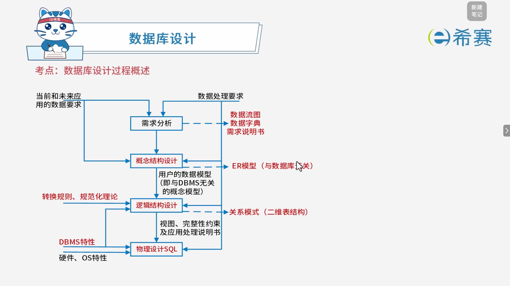

# 数据库设计过程概述

## 1. 考点：数据库设计过程

## 2. 经典例题

### 2.1 题目一

> **题目：**  关系规范化在数据库设计的（ ）阶段进行。
>
> - A、需求分析
> - B、概念设计
> - C、逻辑设计
> - D、物理设计

 **【解析】**

- **正确答案：C**
- **解析说明：**

  - **关于选项 C（逻辑设计）** ​：关系规范化（如将关系模式转换为 1NF、2NF、3NF、BCNF 等）是在数据库的**逻辑设计**阶段进行的。逻辑设计阶段将概念模型转换为逻辑模型（如关系模型），并进行规范化处理，以消除数据冗余和异常。
  - **其他选项说明**：

    - **A、需求分析**：主要任务是收集和分析用户需求。
    - **B、概念设计**：主要任务是设计概念模型（如 E-R 图）。
    - **D、物理设计**：主要任务是确定数据的物理存储结构（如索引、文件组织等）。

**正确答案：C（逻辑设计）。**
