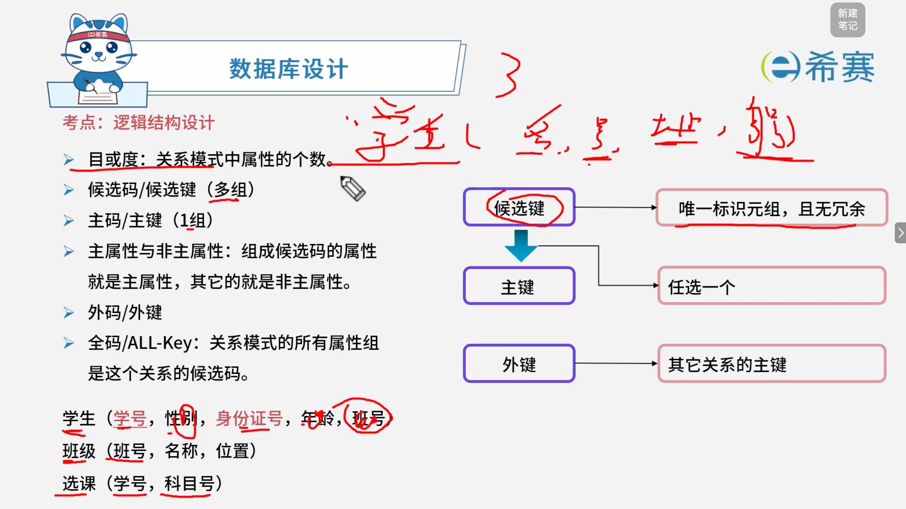
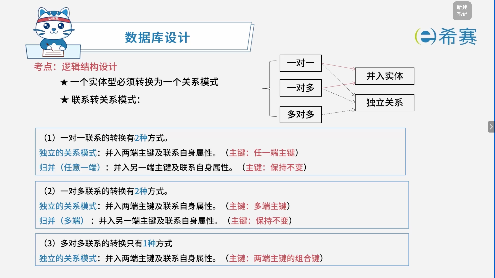
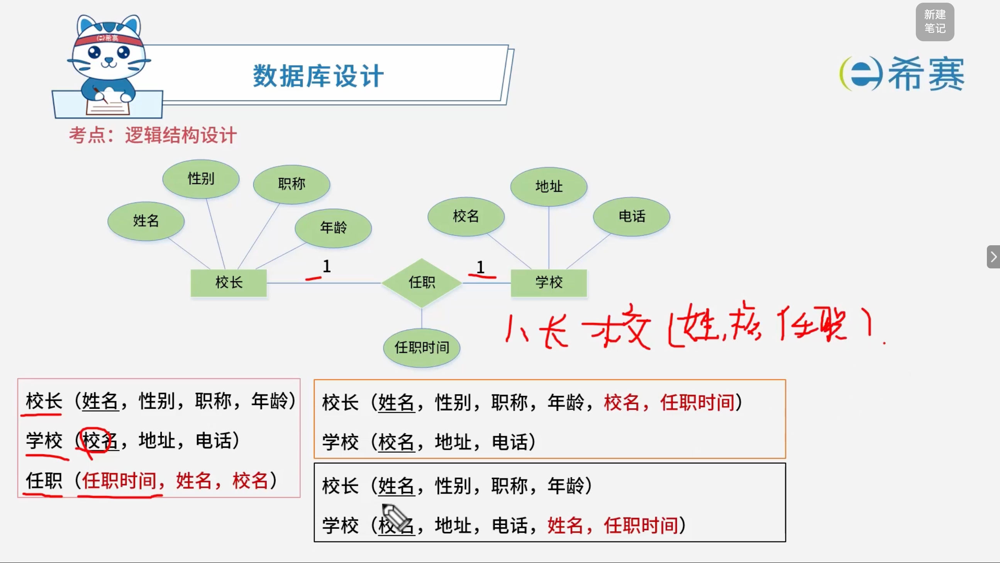
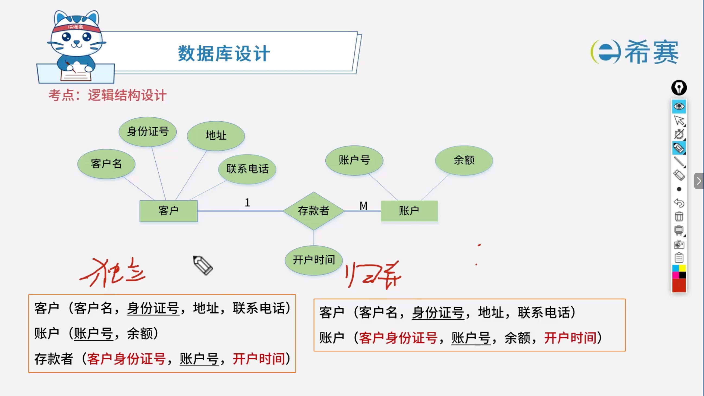
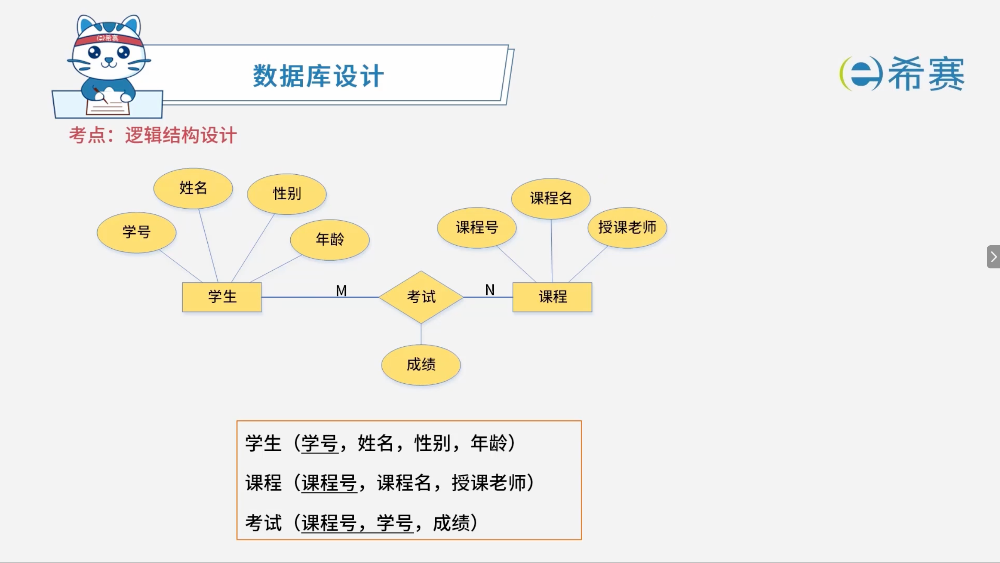

# 数据库逻辑结构设计

## 1. 考点：常见的数据模型

### 1.1 常见数据模型与深度解析

数据库模型是用来描述数据、数据联系和数据语义的工具。在逻辑结构设计中，主要包含以下几种常见的数据模型：

#### 1.1.1 层次模型 (Hierarchical Model)

- **结构特点**​：采用**树状结构**组织数据。有且仅有一个根节点；其余节点有且仅有一个父节点（表现为 1 对多的关系）。
- **典型应用**：早期的主机系统、文件系统、企业组织架构等。
- **优缺点**：

  - **优点**：数据结构清晰、简单；对具有天然层次关系的数据查询效率很高。
  - **缺点**：无法直接表示多对多（N:M）的复杂关系；当根节点或父节点发生变动时，结构调整较麻烦（插入和删除操作受限）。

#### 1.1.2 网状模型 (Network Model)

- **结构特点**​：采用​**图状结构**（有向图）组织数据。允许一个以上的节点无父节点，允许一个节点有多个父节点，能够直接表示多对多（N:M）关系。
- **典型应用**：复杂的工业控制系统、早期的网状数据库管理系统。
- **优缺点**：

  - **优点**：能够更为直接地模拟现实世界中的复杂多对多关系，数据共享性好。
  - **缺点**：结构庞大复杂；用户的导航式操作依赖于存取路径，应用程序编写复杂，维护难度高。

#### 1.1.3 关系模型 (Relational Model)

- **结构特点**：采用二维表格（Table）来组织数据。行表示元组（记录），列表示属性（字段）。表与表之间通过主键和外键建立关联。
- **典型应用**：绝大多数现代关系型数据库（如 MySQL、Oracle、SQL Server、PostgreSQL）。
- **优缺点**：

  - **优点**：建立在严格的数学基础（集合代数和关系演算）之上；概念单一、直观，用户无需了解底层物理存储细节；具有极高的数据独立性（物理独立性和逻辑独立性）。
  - **缺点**：对于处理具有复杂层次或高度嵌套图结构的数据时，性能和表达能力不如非关系模型。

#### 1.1.4 面向对象模型 (Object-Oriented Model)

- **结构特点**​：结合了面向对象程序设计语言的思想，以**对象**为基本单位。对象包含数据（属性）和代码（方法），支持封装、继承和多态。
- **典型应用**：计算机辅助设计（CAD）、地理信息系统（GIS）、面向对象数据库及支持对象特性的现代关系数据库。
- **优缺点**：

  - **优点**：能够完美对接面向对象的编程语言，无缝建模复杂的现实世界实体及行为，减少了对象与关系之间的阻抗不匹配。
  - **缺点**：理论和标准不如关系模型成熟统一；在处理传统大规模简单结构数据的批量查询时，性能通常不及关系模型。

### 1.2 数据模型三要素

无论采用哪种数据模型，其设计与实现均离不开以下三个基本要素：

- **数据结构**：描述数据库的组成对象以及对象之间的联系，决定了数据库系统的静态特性。
- **数据操作**：对数据库中各种对象的实例允许执行的操作的集合，包括查询、插入、删除和修改等，决定了数据库系统的动态特性。
- **数据的约束条件**：一组完整性规则的集合，用以限定数据库状态及其变化，确保数据的正确性、有效性和相容性。

### 1.3 关系模式实例（银行客户与账户）

在实际关系模型设计中，通常会将实体和多对多联系转化为对应的关系模式。例如银行存取款业务的经典关系模式：

- **客户**​（​`客户名`​, ​`身份证号`​, ​`地址`​, ​`联系电话`）
- **账户**​（​`账号`​, ​`余额`）
- **存款者**​（​`客户身份证号`​, ​`账号`​, ​`开户时间`）

## 2. 考点：数据的约束条件

### 2.1 实体完整性约束 (Entity Integrity)

- **核心定义**：针对关系中的主键（Primary Key）进行约束。
- **基本规则**​：要求主键必须具备**唯一性**且**非空**。
- **深度解析**：

  - **唯一性**：表中每一行记录在主键列上必须拥有唯一的值，严禁出现重复的主键，以此确保每一条记录都可以被准确无误地独立标识。
  - **非空性**​：主键的所有组成列绝对不能取空值（​`NULL`），因为空值意味着“未知”或“不存在”，无法起到唯一标识记录的作用。
  - **复合主键特例**：当主键由多个属性组合而成时，组成该复合主键的所有列均不可为空，且这些列的组合整体必须保持唯一。

### 2.2 参照完整性约束 (Referential Integrity)

- **核心定义**：针对关系之间的外键（Foreign Key）进行约束。
- **基本规则**​：要求外键的值必须是其他关系（被引用表）的主键值，或者取空值（​`NULL`）。
- **深度解析**：

  - **核心作用**：用于维护两个或多个表之间的逻辑关联（即实体间的联系）。例如在电商系统中，“订单表”中的客户编号必须对应“客户表”中真实存在的客户主键。
  - **级联与限制策略**：当对父表（主表）执行删除或修改主键操作时，若子表中存在相关联的外键记录，数据库管理系统（DBMS）通常会根据定义采取以下策略：

    - **拒绝（Restrict / No Action）** ：直接阻止操作。
    - **级联（Cascade）** ：同步自动删除或修改子表中的对应记录。
    - **置空（Set Null）** ​：将子表中的外键列自动设为 ​`NULL`（前提是该外键列允许为空）。

### 2.3 用户自定义完整性约束 (User-Defined Integrity)

- **核心定义**：针对具体业务逻辑与应用需求，由用户自行设定的特定约束条件。
- **深度解析**：

  - 关系模型只提供了实体和参照的通用规则，而现实世界的业务千差万别，因此需要用户自定义规则来保障数据的业务语义。
  - **常见实现形式**：

    - **属性域约束**​：如 ​`CHECK`​ 约束，限定字段的取值范围（例如：员工年龄 ​`age BETWEEN 18 AND 60`，性别只能是“男”或“女”）。
    - **默认值与非空约束**​：如 ​`DEFAULT`​ 和 ​`NOT NULL`，规范录入时的基础格式。
    - **唯一性约束**​：如 ​`UNIQUE`，确保非主键字段（如手机号、电子邮箱）在表中不重复。
    - **复杂业务触发器**：通过触发器（Trigger）或存储过程实现跨表、跨字段的复杂业务校验逻辑。

## 3. 考点：关系的3种类型

- **基本关系**​（通常又称为​**基本表或基表**）：实际存在的表，实际存储数据的逻辑表示。
- **查询表**：查询结果对应的表。
- **视图表**​：由基表或其他视图表导出的表，本身不独立存储，数据库只存放它的定义，常称为**虚表**。

## 4. 考点：关系模式的核心概念

- **目或度**：关系模式中属性的个数。
- **候选码 / 候选键（多组）** ：唯一标识元组，且无冗余。
- **主码 / 主键（1 组）** ：从候选键中任选一个。
- **主属性与非主属性**：组成候选码的属性就是主属性，其它的就是非主属性。
- **外码 / 外键**：其它关系的主键。
- **全码 / ALL-Key**：关系模式的所有属性组是这个关系的候选码。

### 4.1 关系模式实例

- **学生**​（​`学号`​, 性别, ​`身份证号`, 年龄, 班级号）
- **班级**​（​`班级号`, 名称, 位置）
- **选课**​（​`学号`​, ​`科目号`）

## 5. 考点：E-R 模型向关系模型的转换规则

基本原则：一个实体型必须转换为一个关系模式。 而联系的转换则根据其不同的联系类型分为以下几种方式：

### 5.1 一对一联系 (1:1) 的转换（有 2 种方式）

- **独立的关系模式**​：将联系转换为独立的关系模式，其属性中并入两端的主键及联系自身的属性，主键为**任意一端的主键**。
- **归并（任意一端）** ：将联系归并到任意一端对应的关系模式中，在该关系中并入另一端的主键及联系自身的属性，主键**保持不变**。

#### 5.1.1 实例讲解

### 5.2 一对多联系 (1:N) 的转换（有 2 种方式）

- **独立的关系模式**​：将联系转换为独立的关系模式，其属性中并入两端的主键及联系自身的属性，主键为**多端的主键**。
- **归并（多端）** ：将联系直接归并到**多端**对应的关系模式中，在多端并入另一端的主键及联系自身的属性，主键**保持不变**。

#### 5.2.1 实例讲解

### 5.3 多对多联系 (N:M) 的转换（只有 1 种方式）

- **独立的关系模式**：必须将联系转换为一个独立的关系模式，其属性中并入两端的主键及联系自身的属性，其主键为**两端主键的组合键**。

#### 5.3.1 实例讲解

### 5.4 E-R 模型向关系模式转换规则对比表

|**联系类型**|**实体（独立关系模式）**|**联系（独立关系模式）**|**联系（归并关系模式）**|**备注**|
| --| ----| ----| ----| --------------------------|
|**1 对 1**|$\checkmark$ |$\checkmark$ |$\checkmark$ |并入任意一端|
|**1 对多**|$\checkmark$ |$\checkmark$ |$\checkmark$ |并入多端|
|**多对多**|$\checkmark$ |$\checkmark$ |$\times$ |多对多**不能**归并，必须独立建表|

## 6. 考点：扩展知识-视图、索引、触发器与存储过程对比

- **视图**：保证数据安全，用于查询。
- **触发器**：CRUD 操作时会自动执行，保证数据的正确。
- **存储过程**：简化复杂的操作调用，常见操作什么都能做。
- **索引**：提高查询效率。

## 7. 经典例题

### 7.1 题目一

> **题目：**  数据库的安全机制中，通过提供（ ）供第三方开发人员调用进行数据更新，从而保证数据库的关系模式不被第三方所获取。
>
> - A、触发器
> - B、存储过程
> - C、视图
> - D、索引

 **【解析】**

- **正确答案：B**
- **解析说明：**

  - **关于选项 B（存储过程）** ：存储过程是一组预编译的 SQL 语句，存储在数据库中，可供第三方开发人员直接调用。通过存储过程进行数据更新，第三方开发人员无需了解数据库的关系模式（表结构），从而保证数据库的关系模式不被第三方获取。
  - **其他选项说明**：

    - **A、触发器**：由特定事件自动触发执行，不是供第三方调用的接口。
    - **C、视图**：是虚拟表，用于简化查询和权限控制，但通常用于查询，不直接用于“供第三方调用进行数据更新”。
    - **D、索引**：用于提高查询效率，与安全机制无关。

**正确答案：B（存储过程）。**
