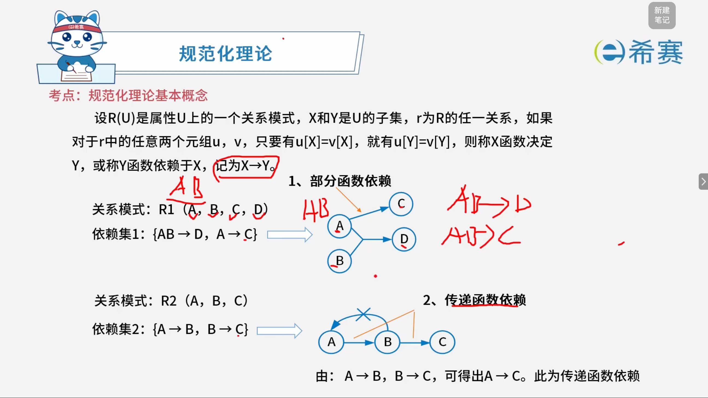
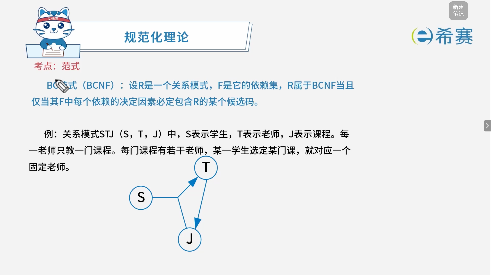
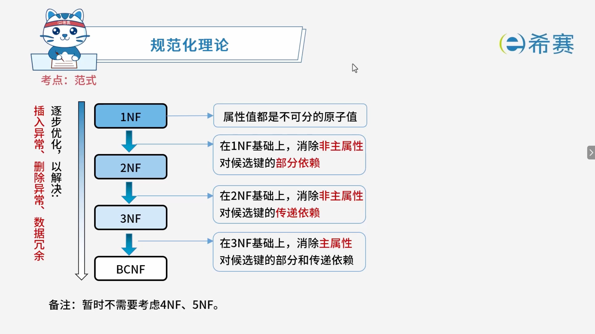

# 规范化

## 1. 考点：规范化理论的基本概念

### 1.1 函数依赖 (Functional Dependency, FD) 的定义

- 设 $R(U)$ 是属性集 $U$ 上的一个关系模式，$X$ 和 $Y$ 是 $U$ 的子集。
- 若对于 $R$ 的任意一个可能关系 $r$，如果对于 $r$ 中的任意两个元组 $u$ 和 $v$，只要 $u[X] = v[X]$，就有 $u[Y] = v[Y]$，则称 **$X$** **函数决定** **$Y$**，或者称 **$Y$** **函数依赖于** **$X$**，记作：$X \to Y$。

### 1.2 典型函数依赖类型实例

#### 1.2.1 部分函数依赖 (Partial Functional Dependency)

- **示例**：

  - 关系模式：$R_1(A, B, C, D)$
  - 依赖集：$\{AB \to D, A \to C\}$
- **图解说明**：在复合属性（主键候选）$\{A, B\}$ 决定 $D$ 的情况下，其真子集 $A$ 能够单独决定 $C$，这种由复合属性的一部分决定其他属性的情况，即为​**部分函数依赖**。

#### 1.2.2 传递函数依赖 (Transitive Functional Dependency)

- **示例**：

  - 关系模式：$R_2(A, B, C)$
  - 依赖集：$\{A \to B, B \to C\}$
- **图解说明**：若 $A \to B$（且 $B \not\to A$），同时 $B \to C$，则由关系可得出 ​**$A \to C$**​。这种通过中间属性传递决定的关系，即为​**传递函数依赖**。

## 2. 考点：规范化理论：Armstrong 推理规则

对于关系模式 $R(U, F)$ 来说，有以下三条基准推理规则（阿姆斯特朗公理）：

- **A1. 自反律 (Reflexivity)** ：若 $Y \subseteq X \subseteq U$，则 $X \to Y$ 成立。
- **A2. 增广律 (Augmentation)** ：若 $Z \subseteq U$ 且 $X \to Y$，则 $XZ \to YZ$ 成立。
- **A3. 传递律 (Transitivity)** ：若 $X \to Y$ 且 $Y \to Z$，则 $X \to Z$ 成立。

### 2.1 常用扩展推理规则

根据上述三条基本推理规则，可以进一步推导出以下三条常用的有效规则：

- **合并规则**：由 $X \to Y$ 和 $X \to Z$，可推出 $X \to YZ$。
- **伪传递规则**：由 $X \to Y$ 和 $WY \to Z$，可推出 $XW \to Z$（形象特点：中间多了一个“朋友” $W$）。
- **分解规则**：由 $X \to Y$ 及 $Z \subseteq Y$，可推出 $X \to Z$。

---

## 3. 考点：范式

### 3.1 第一范式

#### 3.1.1 第一范式 (1NF) 的定义

- **核心概念**：在关系模式 $R$ 中，当且仅当所有域只包含原子值，即每个属性都是不可再分的数据项，则称关系模式 $R$ 是第一范式。

#### 3.1.2 实例分析与调整

- **示例问题**：

  - 关系模式 $R(\text{系名称}, \text{高级职称人数})$ 是否满足 $1NF$，如果不满足，应如何调整？

|**系名称**|**高级职称人数**||
| ----------| ---| ----|
||**教授**|**副教授**|
|计算机系|6|10|
|电子系|3|5|

- **分析说明**：

  - 从上表可以看出，“高级职称人数”这一属性下又分成了“教授”和“副教授”两列，这意味着属性值是​**可再分的复合项**​，因此**不满足**第一范式。
- **调整方案**：

  - 将表结构拆分为不可再分的原子属性，调整后的关系模式可以表示为：

    $$
    R(\text{系名称}, \text{职称}, \text{人数})
    $$
  - 或者展开为平铺的原子列：

    $$
    R(\text{系名称}, \text{教授人数}, \text{副教授人数})
    $$

### 3.2 第二范式

#### 3.2.1 第二范式 (2NF) 的定义

- **核心概念**：当且仅当实体 $E$ 是第一范式 ($1NF$)，且每一个非主属性​**完全依赖主键**​（​**不存在部分函数依赖**）时，则称实体 $E$ 是第二范式。

#### 3.2.2 经典实例分析：“选课表”

设关系模式为：$R(\text{学号}, \text{课程号}, \text{成绩}, \text{学分})$

- **主键分析**：

  - 主键由 $(\text{学号}, \text{课程号})$ 组成。
- **函数依赖分析**：

  - $(\text{学号}, \text{课程号}) \to \text{成绩}$（完全函数依赖）
  - 课程号 $\to$ 学分（部分函数依赖，因为只要知道课程号就能确定学分，不需要学号）
- **结论**：因为存在非主属性“学分”对主键的部分函数依赖（课程号 $\to$ 学分），所以该关系模式**不满足**第二范式。

#### 3.2.3 思考题剖析：不满足 2NF 带来的问题与解决方案

- **存在的问题**：

  - **数据冗余**：同一门课程被多名学生选修时，其“学分”会被重复存储多次。
  - **更新异常**：若某门课程的学分发生变更，需要更新所有选修该门课程的记录，若漏掉部分行会导致数据不一致。
  - **插入异常**：如果开设了一门新课程，但暂时还没有学生选修，由于主键包含“学号”（不能为空），该课程的“学分”信息将无法插入数据库。
  - **删除异常**：如果某门课程的所有学生都退选了，删除学生记录的同时，该课程的“学分”信息也会连带被抹去。
- **解决方案**：

  - 进行​**模式分解**，消除部分函数依赖，将其拆分为满足更高范式的多个关系模式：

    - 学生选课表：$R_1(\text{学号}, \text{课程号}, \text{成绩})$
    - 课程信息表：$R_2(\text{课程号}, \text{学分})$

### 3.3 第三范式

#### 3.3.1 第三范式 (3NF) 的定义

- **核心概念**：当且仅当实体 $E$ 是第二范式 ($2NF$)，且 $E$ 中没有非主属性传递依赖于候选码时（​**不存在传递依赖**），则称实体 $E$ 是第三范式。

#### 3.3.2 经典实例分析：“学生与系部表”

设关系模式为：$R(\text{学号}, \text{姓名}, \text{系号}, \text{系名}, \text{系位置})$

- **主键与依赖分析**：

  - 候选码（主键）：$\text{学号}$
  - 非主属性：$\text{姓名}, \text{系号}, \text{系名}, \text{系位置}$
  - 存在函数依赖：$\text{学号} \to \text{系号}$，同时 $\text{系号} \to (\text{系名}, \text{系位置})$。
  - 这导致非主属性对主键产生了传递依赖（$\text{学号} \to \text{系号} \to \text{系名}$）。
- **结论**​：因为存在非主属性对主键的传递函数依赖，所以该关系模式**不满足**第三范式。

#### 3.3.3 思考题剖析：不满足 3NF 带来的问题与解决方案

- **存在的问题**：

  - **数据冗余**：同一个系的名称和系位置会随着该系每个学生的记录而被重复存储多次。
  - **更新异常**：如果某系搬迁或更改系名，需要更新该系所有学生的记录，若漏掉部分行会导致数据不一致。
  - **插入异常**：如果某个新系刚成立，暂时还没有招收学生，由于主键是“学号”（不能为空），该系的系名和系位置信息将无法插入数据库。
  - **删除异常**：如果某系的所有学生都退学或转系了，删除学生记录的同时，该系的系名和系位置信息也会连带被抹去。
- **解决方案**：

  - 进行​**模式分解**，消除传递函数依赖，将其拆分为满足第三范式的多个关系模式：

    - 学生信息表：$R_1(\text{学号}, \text{姓名}, \text{系号})$
    - 系部信息表：$R_2(\text{系号}, \text{系名}, \text{系位置})$

### 3.4 BC范式

#### 3.4.1 BCNF 的定义

- **核心概念**：设 $R$ 是一个关系模式，$F$ 是它的函数依赖集，$R$ 属于 $\text{BCNF}$ 当且仅当其 $F$ 中每个依赖的**决定因素必定包含** **$R$** **的某个候选码**。
- **通俗理解**：在 $\text{BCNF}$ 中，每一个决定因素都必须是候选码（即“主属性”或能决定全部属性的属性组），消除了主属性对主属性的部分与传递函数依赖。

#### 3.4.2 经典实例分析：“学生-老师-课程表 ($STJ$)”

- **基本设定**：

  - 关系模式：$STJ(S, T, J)$
  - 语义解释：$S$ 表示学生，$T$ 表示老师，$J$ 表示课程。
  - 业务规则：

    1. 每一老师只教一门课程。
    2. 每门课程有若干老师。
    3. 某一学生选定某门课程，就对应一个固定老师。
- **函数依赖与候选码分析**：

  - 根据业务规则，存在函数依赖：$SJ \to T$（学生和课程可决定老师），同时 $T \to J$（老师可决定课程）。
  - 候选码为 $(S, J)$ 和 $(S, T)$。
  - 考察依赖 $T \to J$，其决定因素是 $T$，但 $T$ 单独并不是候选码（候选码包含 $S$ 或由多个属性组成），因此该关系模式**不属于** $\text{BCNF}$。

## 4. 总结

## 5. 经典例题

### 5.1 题目一

> **题目：**  关系模式 $P(A, B, C, D, E, F, G, H, I, J)$ 满足下列函数依赖：$FD = \{ABD \to E, AB \to G, B \to F, C \to J, CJ \to I, G \to H\}$，求候选码？

 **【解析】**

- **正确答案：**  $ABCD$
- **解析说明：**

  - **求属性闭包**：先看函数依赖的右边，出现的属性有：$E$、$G$、$F$、$J$、$I$、$H$。未出现在右边的属性为：$A$、$B$、$C$、$D$，这些属性一定包含在候选码中。
  - **计算** **$ABCD$** **的闭包**：

    - $ABD \to E$，得到 $E$；
    - $AB \to G$，得到 $G$；
    - $B \to F$，得到 $F$；
    - $C \to J$，得到 $J$；
    - $CJ \to I$，得到 $I$；
    - $G \to H$，得到 $H$。
  - 最终闭包为 $ABCDEFGHIJ$，包含全部属性，因此 $ABCD$ 是候选码。
  - **验证最小性**：去掉 $A$、$B$、$C$、$D$ 中任意一个，都无法推出全部属性，因此 $ABCD$ 是最小候选码。

---

### 5.2 题目二

> **题目：**  关系 $R(A, B, C)$ 满足下列函数依赖：$F = \{B \to C, B \to A, A \to BC\}$，关系 $R$ 的候选关键字为\_\_\_。
>
> - A、$AB$
> - B、$A$ 和 $B$
> - C、$A$ 和 $BC$
> - D、$AC$ 和 $AB$

 **【解析】**

- **正确答案：**  B
- **解析说明：**

  - **求属性闭包**：

    - $B \to C$，$B \to A$，所以 $B$ 的闭包为 $B^+ = \{B, C, A\}$，包含全部属性，因此 $B$ 是候选码。
    - $A \to BC$，所以 $A$ 的闭包为 $A^+ = \{A, B, C\}$，包含全部属性，因此 $A$ 是候选码。
  - **验证最小性**：$B$ 单独可以推出全部属性，$A$ 单独也可以推出全部属性，因此 $A$ 和 $B$ 都是候选码。

**正确答案：**  B（$A$ 和 $B$）。

---

### 5.3 题目三

> **题目：**  若给定的关系模式为 $R$，属性集 $U = \{A, B, C\}$，函数依赖集 $F = \{AB \to C, C \to B\}$，则关系 $R$（ ）。
>
> - A、有 $2$ 个候选关键字 $AC$ 和 $BC$，并且有 $3$ 个主属性
> - B、有 $2$ 个候选关键字 $AC$ 和 $AB$，并且有 $3$ 个主属性
> - C、只有一个候选关键字 $AC$，并且有 $1$ 个非主属性和 $2$ 个主属性
> - D、只有一个候选关键字 $AB$，并且有 $1$ 个非主属性和 $2$ 个主属性

 **【解析】**

- **正确答案：**  B
- **解析说明：**

  - **求候选关键字**：

    - 因为 $AB \to C$，所以 $AB$ 的闭包为 $(AB)^+ = \{A, B, C\}$，包含全部属性，因此 $AB$ 是候选码。
    - 因为 $C \to B$，结合自反律可知 $AC \to AB$，进而可推导出 $(AC)^+ = \{A, C, B\}$，包含全部属性，因此 $AC$ 也是候选码。
    - $BC$ 的闭包为 $(BC)^+ = \{B, C\}$，不包含 $A$，因此 $BC$ 不是候选码。
  - **确定主属性**：

    - 主属性定义为包含在任何一个候选码中的属性。
    - 候选码为 $AB$ 和 $AC$，涉及的属性有 $A$、$B$、$C$，因此这 $3$ 个属性都是主属性。
  - **判断选项**：

    - A：候选关键字为 $AC$ 和 $BC$，错误。
    - B：候选关键字为 $AC$ 和 $AB$，且有 $3$ 个主属性，正确。
    - C：只有一个候选关键字 $AC$，错误。
    - D：只有一个候选关键字 $AB$，错误。

**正确答案： B（有** **$2$** **个候选关键字** **$AC$** **和** **$AB$** **，并且有** **$3$** **个主属性）。** 

---

### 5.4 题目四

> **题目：**  给定关系模式 $R(U, F)$，其中 $U$ 为关系模式 $R$ 中的属性集，$F$ 是 $U$ 上的一组函数依赖。假设 $U = \{A_1, A_2, A_3, A_4\}$，$F = \{A_1 \to A_2, A_1A_2 \to A_3, A_1 \to A_4, A_2 \to A_4\}$，那么关系 $R$ 的主键应为（ ）。函数依赖集 $F$ 中的（ ）是冗余的。
>
> **第一组选项：**
>
> - A、$A_1$
> - B、$A_1A_2$
> - C、$A_1A_3$
> - D、$A_1A_2A_3$
>
> **第二组选项：**
>
> - A、$A_1 \to A_2$
> - B、$A_1A_2 \to A_3$
> - C、$A_1 \to A_4$
> - D、$A_2 \to A_4$

 **【解析】**

- **正确答案：**  第一空选 A，第二空选 C。
- **解析说明：**

  - **第一空：关系** **$R$** **的主键应为（ A ）**

    - 计算 $A_1$ 的闭包：

      - $A_1 \to A_2$，得到 $A_2$；
      - $A_1 \to A_4$，得到 $A_4$；
      - $A_1A_2 \to A_3$，由 $A_1$ 和 $A_2$ 推出 $A_3$。
    - 因此，$A_1^+ = \{A_1, A_2, A_3, A_4\}$，包含全部属性。
    - $A_1$ 单独可以推出全部属性，且 $A_1$ 是最小的，因此 $A_1$ 是主键。
  - **第二空：函数依赖集** **$F$** **中的（ C ）是冗余的。**

    - 判断 $A_1 \to A_4$ 是否冗余：

      - 从 $F$ 中去掉 $A_1 \to A_4$，得到 $F' = \{A_1 \to A_2, A_1A_2 \to A_3, A_2 \to A_4\}$。
      - 计算 $A_1$ 在 $F'$ 下的闭包：

        - $A_1 \to A_2$，得到 $A_2$；
        - $A_2 \to A_4$，得到 $A_4$；
        - $A_1A_2 \to A_3$，得到 $A_3$。
      - $A_1^+ = \{A_1, A_2, A_3, A_4\}$，仍然包含全部属性。
      - 因此，$A_1 \to A_4$ 可以由其他函数依赖推导出来，是冗余的。

**正确答案： 第一空 A（** **$A_1$** **），第二空 C（** **$A_1 \to A_4$** **）。** 

---

### 5.5 题目五

> **题目：**  给定关系模式 $R\langle U, F\rangle$，其中 $U$ 为属性集，$F$ 是 $U$ 上的一组函数依赖，那么 Armstrong 公理系统的伪传递律是指（ ）。
>
> - A、若 $X \to Y$，$X \to Z$，则 $X \to YZ$ 为 $F$ 所蕴涵
> - B、若 $X \to Y$，$WY \to Z$，则 $XW \to Z$ 为 $F$ 所蕴涵
> - C、若 $X \to Y$，$Y \to Z$ 为 $F$ 所蕴涵，则 $X \to Z$ 为 $F$ 所蕴涵
> - D、若 $X \to Y$ 为 $F$ 所蕴涵，且 $Z \subseteq U$，则 $XZ \to YZ$ 为 $F$ 所蕴涵

 **【解析】**

- **正确答案：**  B
- **解析说明：**

  - **关于选项 B（伪传递律）：**  Armstrong 公理系统中的伪传递律是指：若 $X \to Y$，$WY \to Z$，则 $XW \to Z$ 为 $F$ 所蕴涵。
  - **其他选项说明：**

    - A、​**合并律**：若 $X \to Y$，$X \to Z$，则 $X \to YZ$。
    - C、​**传递律**：若 $X \to Y$，$Y \to Z$，则 $X \to Z$。
    - D、​**增广律**：若 $X \to Y$，且 $Z \subseteq U$，则 $XZ \to YZ$。

**正确答案： B（若** **$X \to Y$** **，** **$WY \to Z$** **，则** **$XW \to Z$** **为** **$F$** **所蕴涵）。** 

### 5.6 题目六

> **题目：**  某公司数据库中的元件关系模式为 P*P*（元件号，元件名称，供应商，供应商所在地，库存量），函数依赖集 F*F* 如下所示：F\={元件号→元件名称,(元件号,供应商)→库存量,供应商→供应商所在地}*F*\={元件号→元件名称,(元件号,供应商)→库存量,供应商→供应商所在地}。
>
> 元件关系的主键为（ ），该关系存在冗余以及插入异常和删除异常等问题。为了解决这一问题需要将元件关系分解（ ），分解后的关系模式可以达到（ ）。
>
> **第一组选项：**
>
> - A、元件号，元件名称
> - B、元件号，供应商
> - C、元件号，供应商所在地
> - D、供应商，供应商所在地
>
> **第二组选项：**
>
> - A、元件1（元件号，元件名称，库存量）、元件2（供应商，供应商所在地）
> - B、元件1（元件号，元件名称）、元件2（供应商，供应商所在地，库存量）
> - C、元件1（元件号，元件名称）、元件2（元件号，供应商，库存量）、元件3（供应商，供应商所在地）
> - D、元件1（元件号，元件名称）、元件2（元件号，库存量）、元件3（供应商，供应商所在地）、元件4（供应商所在地，库存量）
>
> **第三组选项：**
>
> - A、1NF
> - B、2NF
> - C、3NF
> - D、BCNF

 **【解析】**

- **正确答案：第一空选 B，第二空选 C，第三空选 C。**
- **解析说明：**

  - **第一空：元件关系的主键为（ B ）**

    - 计算 (元件号,供应商)(元件号,供应商) 的闭包：

      - 元件号→元件名称元件号→元件名称，得到 元件名称元件名称；
      - (元件号,供应商)→库存量(元件号,供应商)→库存量，得到 库存量库存量；
      - 供应商→供应商所在地供应商→供应商所在地，得到 供应商所在地供应商所在地。
    - 因此，(元件号,供应商)+\={元件号,元件名称,供应商,供应商所在地,库存量}(元件号,供应商)+\={元件号,元件名称,供应商,供应商所在地,库存量}，包含全部属性。
    - (元件号,供应商)(元件号,供应商) 是最小的候选码，因此主键为​**元件号，供应商**。
  - **第二空：为了解决这一问题需要将元件关系分解（ C ）**

    - 原关系模式存在​**非主属性对码的部分函数依赖**：

      - 元件号→元件名称元件号→元件名称，元件名称只依赖于元件号，不依赖于供应商；
      - 供应商→供应商所在地供应商→供应商所在地，供应商所在地只依赖于供应商，不依赖于元件号。
    - 为了解决这一问题，需要按照**函数依赖的保持性**进行分解：

      - 元件1（元件号，元件名称）
      - 元件2（元件号，供应商，库存量）
      - 元件3（供应商，供应商所在地）
    - 这样分解后，每个关系模式都满足 3NF。
  - **第三空：分解后的关系模式可以达到（ C ）**

    - 分解后：

      - 元件1（元件号，元件名称）：元件号是主键，不存在部分依赖和传递依赖，满足 3NF。
      - 元件2（元件号，供应商，库存量）：主键是（元件号，供应商），库存量完全依赖于主键，不存在部分依赖和传递依赖，满足 3NF。
      - 元件3（供应商，供应商所在地）：供应商是主键，供应商所在地完全依赖于主键，不存在部分依赖和传递依赖，满足 3NF。
    - 因此，分解后的关系模式可以达到 ​**3NF**。

**正确答案：第一空 B（元件号，供应商），第二空 C（元件1（元件号，元件名称）、元件2（元件号，供应商，库存量）、元件3（供应商，供应商所在地）），第三空 C（3NF）。** 

> [!CAUTION]
> ### 5.7 **为什么不是 BCNF？**
>
> **BCNF 的要求**​：对于关系模式中的每一个非平凡函数依赖 X→Y*X*→*Y*，X*X* 必须包含候选码（即 X*X* 是超码）。
>
> 我们来看分解后的三个关系模式：
>
> **元件1（元件号，元件名称）**
>
> - 函数依赖：元件号→元件名称元件号→元件名称
> - 元件号是候选码，也是超码。
> - ✅ 满足 BCNF。
>
> **元件3（供应商，供应商所在地）**
>
> - 函数依赖：供应商→供应商所在地供应商→供应商所在地
> - 供应商是候选码，也是超码。
> - ✅ 满足 BCNF。
>
> **元件2（元件号，供应商，库存量）**
>
> - 函数依赖：(元件号,供应商)→库存量(元件号,供应商)→库存量
> - 候选码是 (元件号,供应商)(元件号,供应商)，决定因素也是 (元件号,供应商)(元件号,供应商)，是超码。
> - ✅ 满足 BCNF。
>
> 从这三个分解后的关系来看，它们​**都满足 BCNF**。
>
> ---
>
> ### 5.8 **那为什么标准答案选 3NF 而不是 BCNF？**
>
> 原因在于：
>
>> **题目问的是“分解后的关系模式可以达到（ ）”，通常取分解后能达到的“最高范式”中“最稳妥、最标准”的答案。**
>>
>
> 但在软考的标准答案里，这道题分解后的结果通常被认为是 ​**3NF**，而不是 BCNF。这看起来矛盾，但实际上是因为：
>
> **软考教材和标准答案中，对“分解后达到的范式”通常以“消除部分依赖和传递依赖”为标准，即 3NF。**
>
> 更准确地说：
>
> - 分解后的三个关系确实​**都满足 BCNF**。
> - 但软考的标准答案往往取 ​**3NF**，因为：
>
>   - 3NF 是“分解后保证函数依赖保持性”的常见目标；
>   - BCNF 可能不保持函数依赖，而 3NF 可以同时保持函数依赖和无损连接。
>
> 所以这道题如果严格按 BCNF 定义去判断，分解后的关系确实也满足 BCNF；但​**软考标准答案取 C（3NF）** 。
