# 数据库设计

## 1. 考点：数据库的设计过程

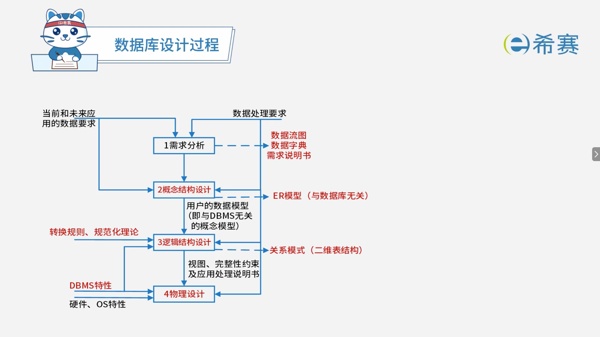

## 2. 考点：考察形式

### 2.1 E-R模型-联系类型判断

#### 2.1.1 二元联系

 **【普通二元联系】**

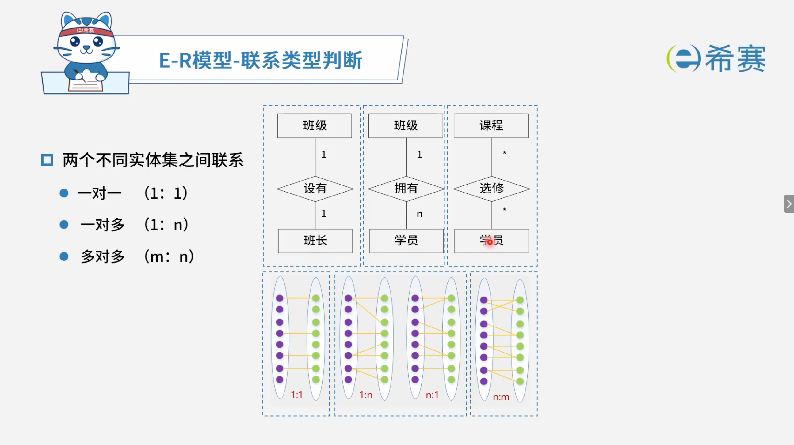

 **【同一个实体集中的二元联系】**

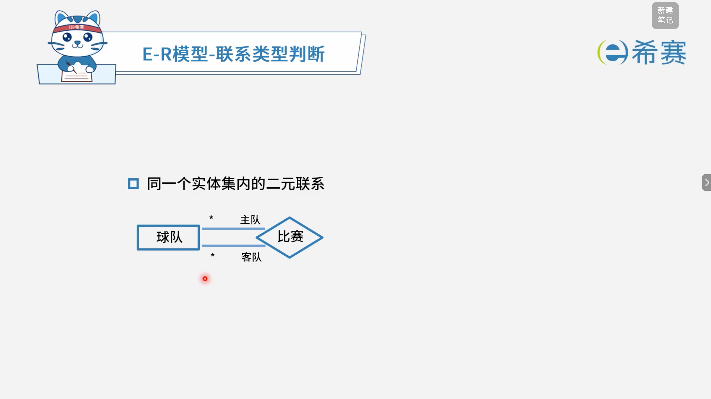

#### 2.1.2 三元联系

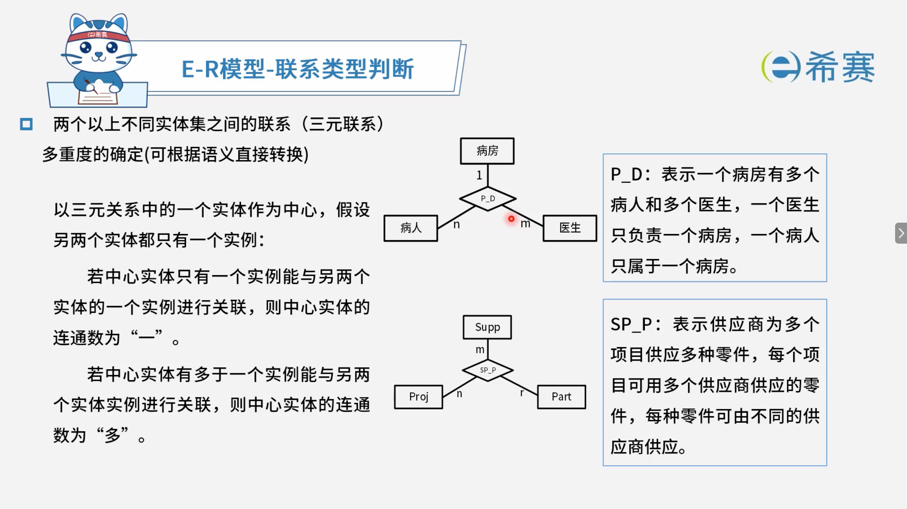

### 2.2 扩充的E-R模型（弱实体、特殊化、聚集）

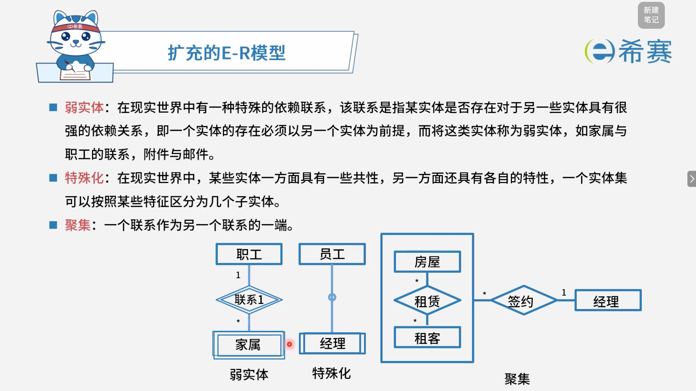

### 2.3 完整性约束

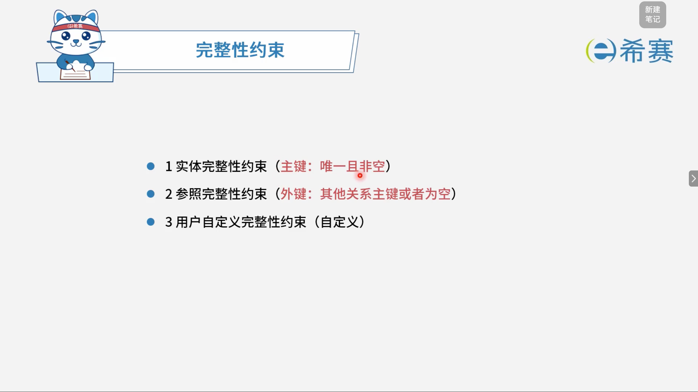

### 2.4 逻辑结构设计-E-R模型转关系模式

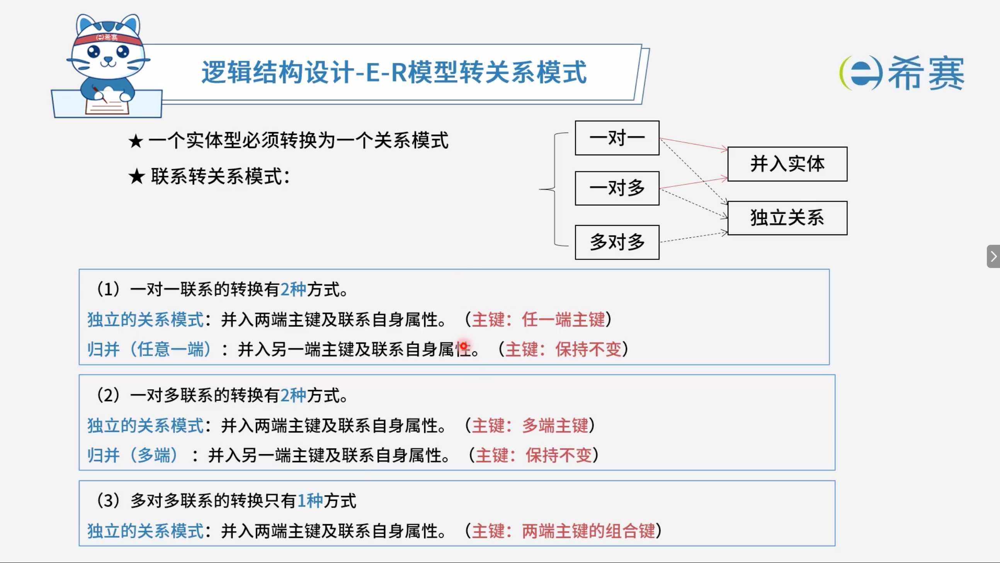

### 2.5 规范化理论-范式

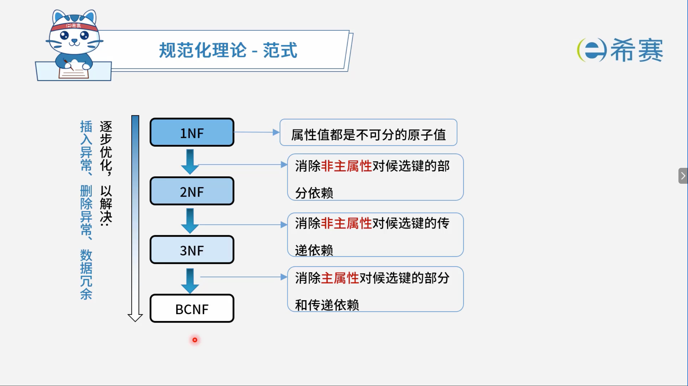

## 3. 考点：答题技巧

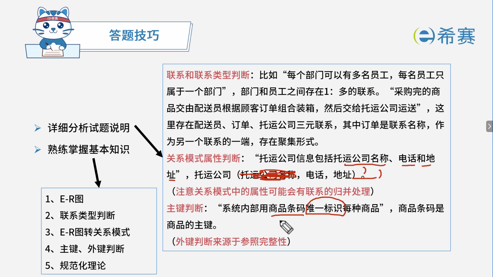

## 4. 实战演练

### 4.1 题目一

> 阅读下列说明，回答问题1至问题3，将解答填入答题纸的对应栏内。
>
>  **【说明】**
>
> 某宾馆为了有效地管理客房资源，满足不同客户需求，拟构建一套宾馆信息管理系统，以方便宾馆管理及客房预订等业务活动。
>
>  **【需求分析结果】**
>
> 该系统的部分功能及初步需求分析的结果如下：
>
> （1）宾馆有多个部门，部门信息包括部门号、部门名称、电话、经理。每个部门可以有多名员工，每名员工只属于一个部门；每个部门只有一名经理，负责管理本部门。
>
> （2）员工信息包括员工号、姓名、岗位、电话、工资，其中，员工号唯一标识员工关系中的一个元组，岗位有经理、业务员。
>
> （3）客房信息包括客房号（如1301、1302等）、客房类型、收费标准、入住状态（已入住/未入住），其中客房号唯一标识客房关系中的一个元组，不同客房类型具有不同的收费标准。
>
> （4）客户信息包括客户号、单位名称、联系人、联系电话、联系地址，其中客户号唯一标识客户关系中的一个元组。
>
> （5）客户预订客房时，需要填写预订申请。预订申请信息包括申请号、客户号、入住时间、入住天数、客房类型、客房数量，其中，一个申请号唯一标识预订申请中的一个元组；一位客户可以有多个预订申请，但一个预订申请对应唯一的一位客户。
>
> （6）当客户入住时，业务员根据客户的预订申请负责安排入住客房事宜。安排信息包括客房号、姓名、性别、身份证号、入住时间、天数、电话，其中客房号、身份证号和入住时间唯一标识一次安排。一名业务员可以安排多个预订申请，一个预订申请只由一名业务员安排，而且可安排多间同类型的客房。
>
>  **【概念模型设计】**
>
> 根据需求阶段收集的信息，设计的实体联系图如图2-1所示。
>
>  **【关系模式设计】**
>
> 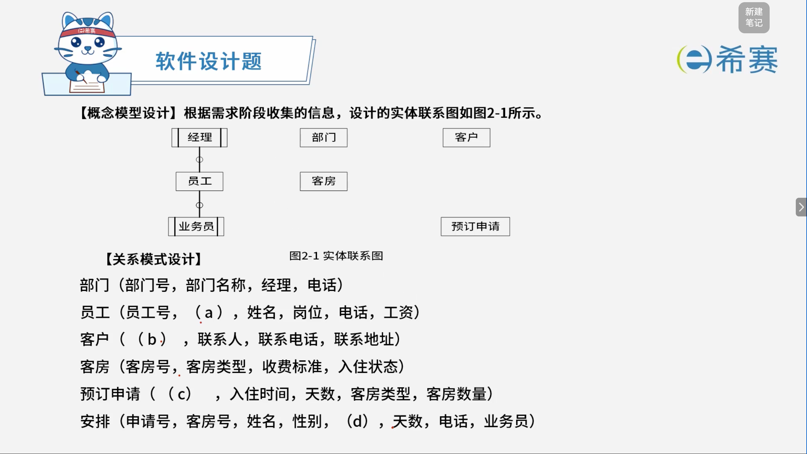
>
> - 部门（部门号，部门名称，经理，电话）
> - 员工（员工号，（ a ），姓名，岗位，电话，工资）
> - 客户（（ b ），联系人，联系电话，联系地址）
> - 客房（客房号，客房类型，收费标准，入住状态）
> - 预订申请（（ c ），入住时间，天数，客房类型，客房数量）
> - 安排（申请号，客房号，姓名，性别，（ d ），天数，电话，业务员）
>
> ---
>
>  **【问题1】** （4分）
>
> 根据问题描述，补充四个联系，完善图2-1的实体联系图-联系名可用联系1、联系2、联系3和联系4代替，联系的类型为1:1、1:n和m:n（或1:1、1:\*和\*:\*）。
>
>  **【问题2】** （8分）
>
> （1）根据题意，将关系模式中的空（a）～（d）补充完整，并填入答题纸对应的位置上。
>
> （2）给出“预订申请”和“安排”关系模式的主键和外键。
>
>  **【问题3】** （3分）
>
> 【关系模式设计】中的“客房”关系模式是否存在规范性问题，请用100字以内文字解释你的观点（若存在问题，应说明如何修改“客房”关系模式）。

 **【解析】**

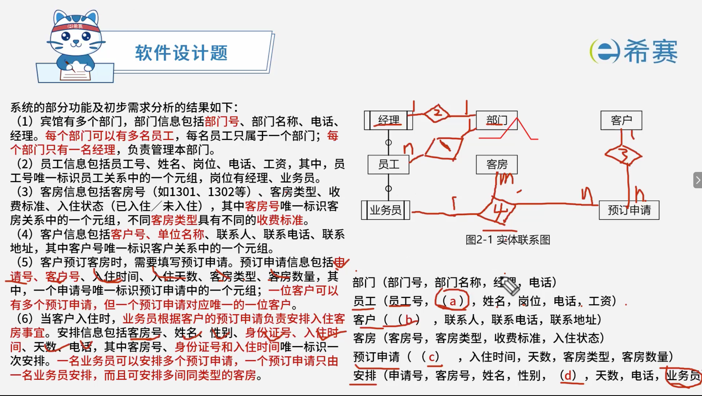

#### 4.1.1 正确答案

 **【问题1】**

- 联系1：部门与员工，1:n（一个部门有多名员工，一名员工只属于一个部门）
- 联系2：部门与经理，1:1（一个部门只有一名经理，一名经理只管理一个部门）
- 联系3：客户与预订申请，1:n（一位客户可以有多个预订申请，一个预订申请对应唯一的一位客户）
- **联系4：业务员、预订申请与客房，三元联系，1:n:m**（一名业务员可以安排多个预订申请，一个预订申请只由一名业务员安排，而且可安排多间同类型的客房）

---

 **【问题2】**

 **（1）补充关系模式中的空：**

- （a）部门号
- （b）客户号，单位名称
- （c）申请号，客户号
- （d）身份证号，入住时间

 **（2）主键和外键：**

- **预订申请**：

  - 主键：申请号
  - 外键：客户号
- **安排**：

  - 主键：客房号，身份证号，入住时间
  - 外键：申请号，业务员，客房号

---

 **【问题3】**

存在规范性问题。

- **问题**：“客房”关系模式中，客房类型与收费标准之间存在函数依赖，即不同客房类型具有不同的收费标准，存在传递函数依赖。
- **修改方法**：将“客房”关系模式分解为两个关系模式：

  - 客房（客房号，客房类型，入住状态）
  - 客房类型（客房类型，收费标准）

‍
