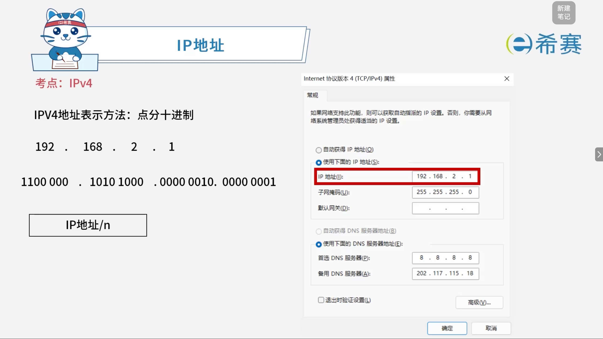
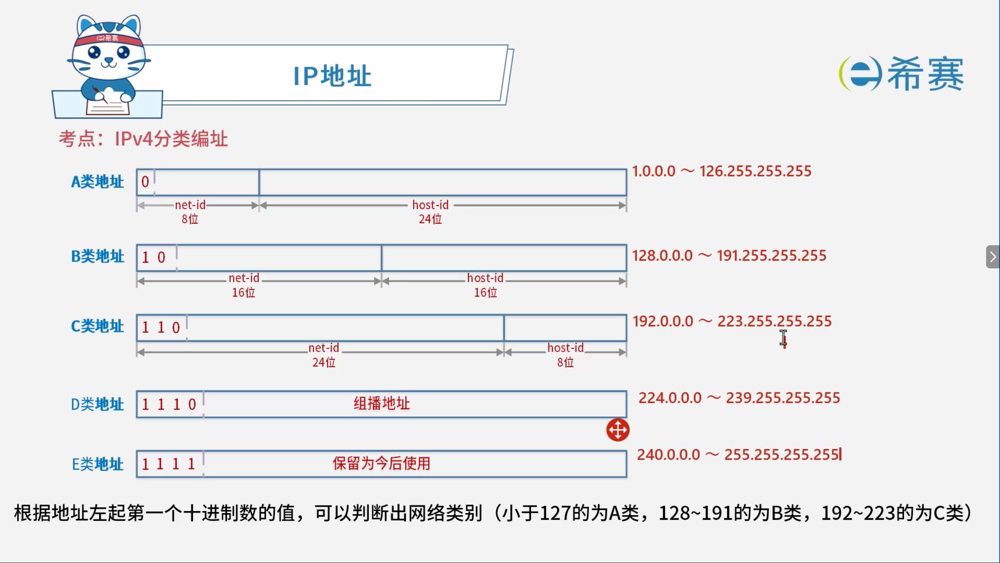

# IP地址

## 1. 考点：IPv4

### 1.1 表示方法

### 1.2 IPv4分类编址

#### 1.2.1 Pv4 分类地址与默认子网掩码对照表

|**类别**|**开头二进制前缀**|**网络号位数**|**主机号位数**|**地址范围**|**默认子网掩码**|
| --| --------| ----------------------| -------| --------| --------|
|**A类**|`0` |8 位|24 位|`1.0.0.0 ~ 126.255.255.255` |`255.0.0.0` |
|**B类**|`10` |16 位|16 位|`128.0.0.0 ~ 191.255.255.255` |`255.255.0.0` |
|**C类**|`110` |24 位|8 位|`192.0.0.0 ~ 223.255.255.255` |`255.255.255.0`|
|**D类**|`1110` |——（组播地址）|——|`224.0.0.0 ~ 239.255.255.255` |——|
|**E类**|`1111` |——（保留今后使用）|——|`240.0.0.0 ~ 255.255.255.255` |——|

#### 1.2.2 核心判断与计算规则

- **根据地址左起第一个十进制数的值判断网络类别**：

  - 小于 127 的为 **A类**。
  - 128 \~ 191 的为 **B类**。
  - 192 \~ 223 的为 **C类**。
- **子网掩码的构成原理**：

  - 子网掩码用于区分 IP 地址中的网络号与主机号。
  - **网络号**对应的字节全置为 `255`（二进制全 `1`），**主机号**对应的字节全置为 `0`（二进制全 `0`）。
  - 因此，A类网（8位网络号）默认子网掩码为 `255.0.0.0`，B类网（16位网络号）为 `255.255.0.0`，C类网（24位网络号）为 `255.255.255.0`。

### 1.3 IPv4 特殊地址对照表

|**IP 地址 / 网段**|**说明**|
| --| ---------------------------------------------------------------------------------|
|**127网段**|回播地址，本地环回地址（常用于本地测试，如`127.0.0.1`）。|
|**主机号非全 0 和非全 1**|可作为子网中的正常主机号使用。|
|**主机号全 0 地址**|代表这个网络本身，可作为子网地址使用。|
|**主机号全 1 地址**|特定子网的广播地址。|
|**169.254.0.0**|保留地址，用于 Windows 系统在 DHCP 失效时的自动私有 IP 寻址 (APIPA)。|
|**0.0.0.0**|保留地址，通常用于 Linux 等系统在 DHCP 失效或未获取到有效 IP 时的默认占位地址。|

## 2. 考点：IPv6

### 2.1 IPv6 核心特性详解

- **更大的地址空间**：

  - IPv6 是旨在替代现行版本 IP 协议（IPv4）的下一代 IP 协议。
  - 其地址长度为 **128位**，地址空间增大了 $2^{96}$ 倍。
- **灵活的 IP 报文头部格式**：

  - 使用一系列固定格式的扩展头部取代了 IPv4 中可变长度的选项字段。
  - 选项部分的出现方式有所变化，使路由器可以简单路过选项而不做任何处理，从而加快了报文处理速度。
- **简化的报文头部**：

  - 简化了报文头部格式，字段只有 **8个**，加快了报文转发，提高了吞吐量。
- **更高的安全性**：

  - 身份认证和隐私权是 IPv6 的关键特性。
- **支持更多的服务类型**。
- **良好的扩展性**：

  - 允许协议继续演变，增加新的功能，使之适应未来技术的发展。

### 2.2 IPv6 的三大地址与通信类型

- **单播地址 (Unicast)** ：

  - 用于单个接口的标识符，实现传统的点对点通信。
- **组播地址 (Multicast)** ：

  - 又称多播地址，实现一点对多点的通信，数据包交付到一组计算机中的每一个。
  - **重要特点**：IPv6 中没有广播的术语，而是将广播看做多播的一个特例。
- **任播地址 (Anycast)** ：

  - 又称泛播地址，这是 IPv6 增加的一种新类型。
  - **重要特点**：任播的目的站是一组计算机，但数据包在交付时只交付给其中一个，通常是距离最近的一个。

### 2.3 IPv6 地址前缀详解

- **多播 (Multicast)** ：

  - 前缀为 `11111111`。
- **任播 (Anycast)** ：

  - 前缀固定，其余位置均为 `0`。
- **单播 (Unicast)** ：

  - **可聚合全球单播地址**：前缀为 `001`。
  - **本地单播地址**：

    - **链路本地**：前缀为 `1111111010`（十六进制表示中一般以 `fe80` 开头）。
    - **站点本地**（范围较大）：前缀为 `1111111011`。
- IPv6 地址类型与前缀对照表

  |**地址类型**|**前缀 (二进制)**|**十六进制标识**|**用途范围**|
  | --| ----------------| ----------------| ---------------------------|
  |**多播地址**|前 8 位`11111111` |以`FF`开头|一对多通信（全球 / 本地）|
  |**任播地址**|复用单播前缀|同对应单播地址|一对多选最近的设备|
  |**全球单播地址**|前 3 位`001` |以`2/3`开头|全球互联网通信|
  |**链路本地单播**|前 10 位`1111111010` |以`fe80`开头|同一物理链路内通信|

## 3. 经典例题

### 3.1 题目一

> **题目：**  在一台安装好 TCP/IP 协议的计算机上，当网络连接不可用时，为了测试编写好的网络程序，通常使用的目的主机 IP 地址为（ ）。
>
> - A、0.0.0.0
> - B、127.0.0.1
> - C、10.0.0.1
> - D、210.225.21.255/24

 **【解析】**

- **正确答案：B**
- **解析说明：**

  - **关于选项 B（127.0.0.1）** ：127.0.0.1 是**回环地址**（本机地址），用于测试本机的网络程序，即使网络连接不可用也可以使用。
  - **其他选项说明**：

    - **A、0.0.0.0**：表示本机所有 IP 地址，通常用于服务器监听，不是测试用的目的地址。
    - **C、10.0.0.1**：是一个私有 IP 地址，需要网络连接可用才能使用。
    - **D、210.225.21.255/24**：是一个广播地址，不能用作目的主机地址。

**正确答案：B（127.0.0.1）。** 

---

### 3.2 题目二

> 题目： IPv6 的地址空间是 IPv4 的（ ）倍。
>
> - **A、4**
> - **B、96**
> - **C、128**
> - **D、**  **$2^{96}$**

【解析】

- **正确答案**：D
- **解析说明**：

  - IPv4 的地址长度是 32 位，其地址空间大小为 $2^{32}$。
  - IPv6 的地址长度是 128 位，其地址空间大小为 $2^{128}$。
  - 因此，IPv6 的地址空间是 IPv4 的 $\frac{2^{128}}{2^{32}} = 2^{128-32} = 2^{96}$ 倍。

**正确答案：D。**

---

### 3.3 题目三

> **题目：**  IP地址块 $155.32.80.192/26$ 包含了（）个主机地址，以下IP地址中，不属于这个网络的地址是（）。
>
> **第一空选项：**
>
> - A. 15
> - B. 32
> - C. 62
> - D. 64
>
> **第二空选项：** 
>
> - A. 155.32.80.202
> - B. 155.32.80.195
> - C. 155.32.80.253
> - D. 155.32.80.191

 **【解析】**

- **第（1）空解析（主机地址数量）：**

  - 子网掩码的掩码位数为 ​`/26`，因此主机位数为 $32 - 26 = 6$ 位。
  - 该地址块包含的总 IP 地址数为 $2^6 = 64$ 个。
  - 除去网络号（首个地址）和广播地址（最后地址）这两个不可分配给主机的特殊地址后，实际包含的可分配主机地址数为 $64 - 2 = 62$ 个。
- **第（2）空解析（不属于该网络的地址）：**

  - IP 地址块为 $155.32.80.192/26$，其起始网络地址为 ​`155.32.80.192`。
  - 广播地址为主机位全为 1 的地址，即 ​`155.32.80.255`。
  - 因此，该网络的有效地址范围是 ​`155.32.80.192`​ 到 ​`155.32.80.255`。
  - 选项 D 中的 ​`155.32.80.191`​ 小于起始地址 ​`192`，因此不属于这个网络。

**正确答案：C、D。** 

---

### 3.4 题目四

> **题目：**  与地址 $220.112.179.92$ 匹配的路由表的表项是（ ）。
>
> - A. $220.112.145.32/22$
> - B. $220.112.145.64/22$
> - C. $220.112.147.64/22$
> - D. $220.112.177.64/22$

 **【解析】**

- 目标 IP 地址为 ​`220.112.179.92`​，我们需要将其第三段数字 ​`179`​ 转换为二进制，看哪个选项的网络前缀（掩码长度为 ​`/22`）能够包含它。
- 子网掩码长度为 ​`/22`​，意味着前 22 位是网络位。前两段 ​`220.112` 是一样的，关键看第三段。
- 将 ​`/22` 对应的第三段范围计算出来：

  - `/22` 掩码在第三段对应的有效位是前 6 位（因为 $22 - 16 = 6$ 位）。
  - 第三段的步长为 $2^{8 - 6} = 4$。
  - 各个选项在第三段的网络号计算如下：

    - A、B、C 选项的第三段都是 ​`145`​ 或 ​`147`​，其网络范围无法覆盖 ​`179`。
    - D 选项 ​`220.112.177.64/22`​：对第三段 ​`177`​ 进行二进制分析，​`177`​ 的二进制是 ​`10110001`​。掩码 ​`/22`​ 锁定了前 6 位（​`101100`​，即十进制的 ​`176`）。
    - 选项 D 的第三段网络起始为 ​`176`​，结束为 ​`179`​（​`176`​ 到 ​`179`​ 刚好是 4 个连续地址，二进制前 6 位均为 ​`101100`​），因此目标地址 ​`220.112.179.92` 属于该子网。

**正确答案：D（220.112.177.64/22）。**

